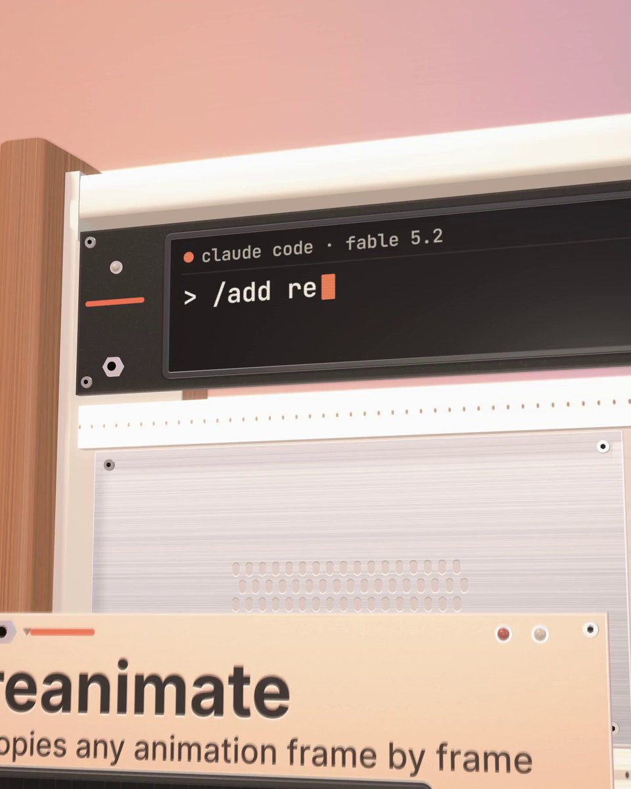
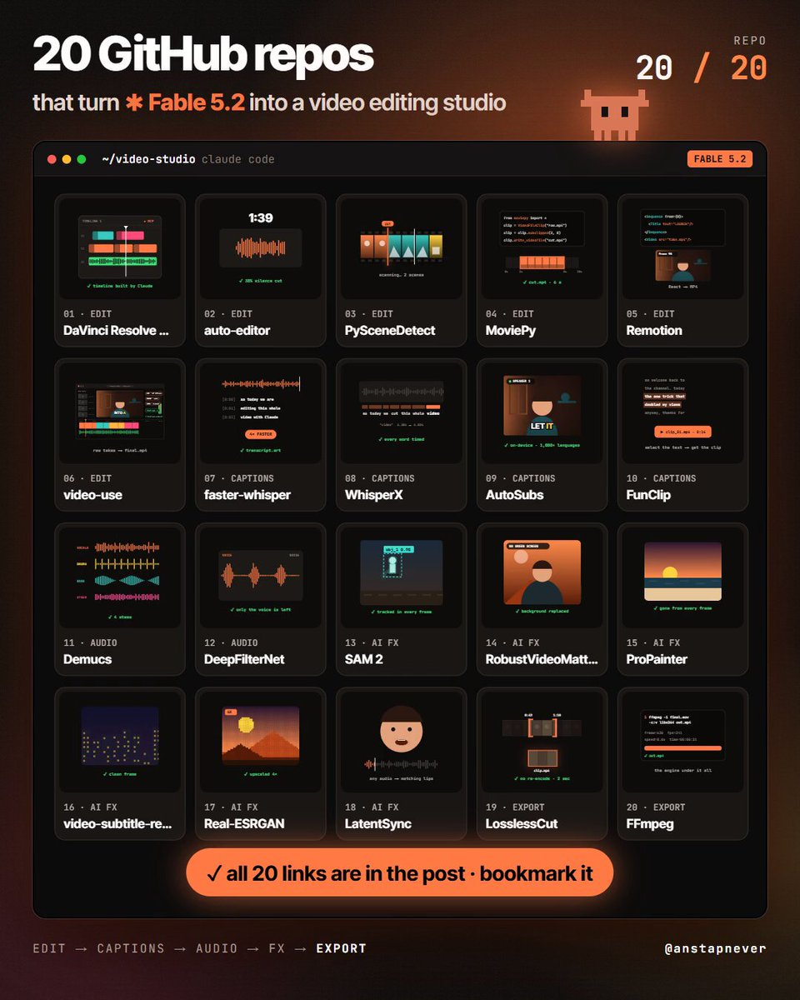
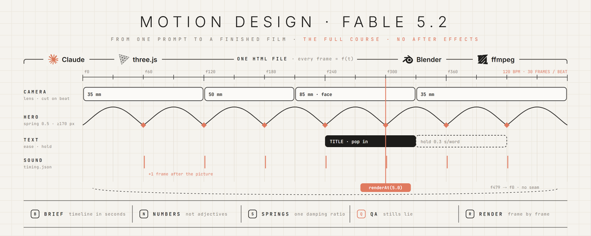
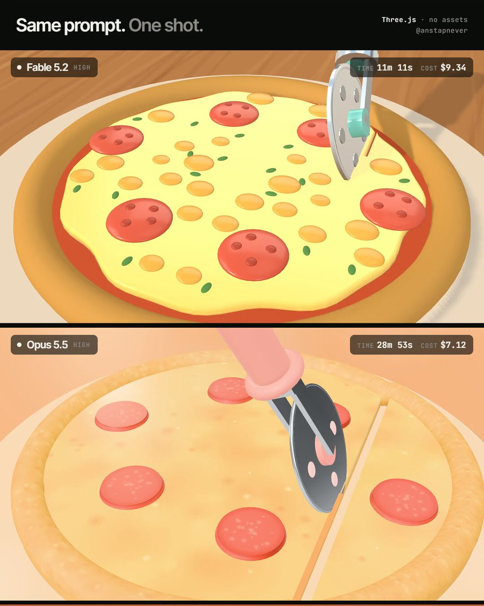
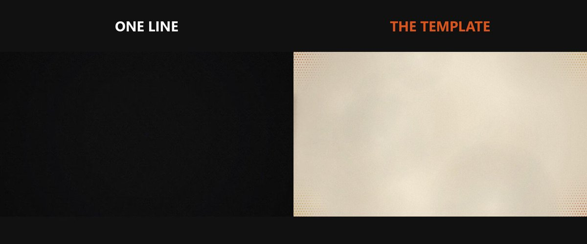
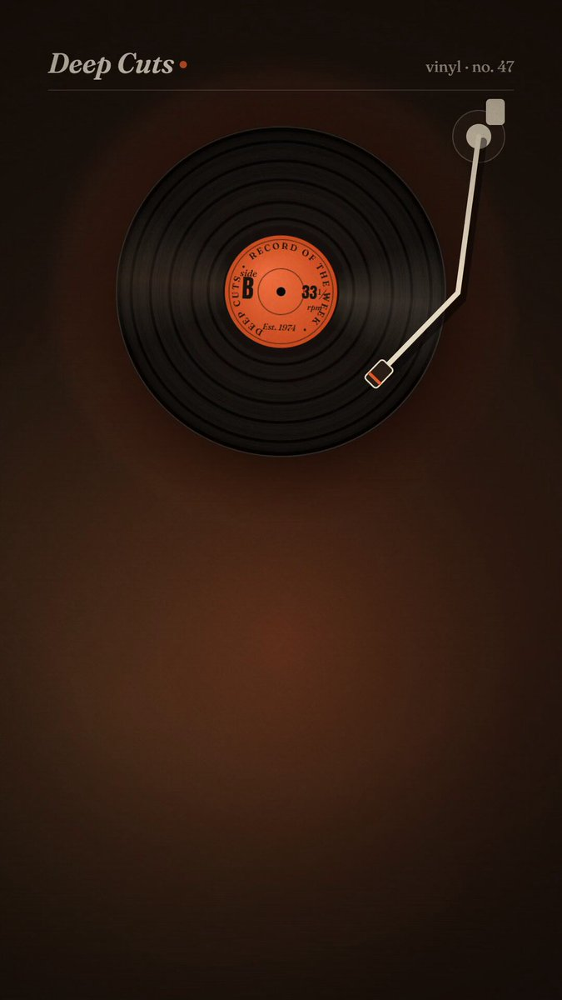
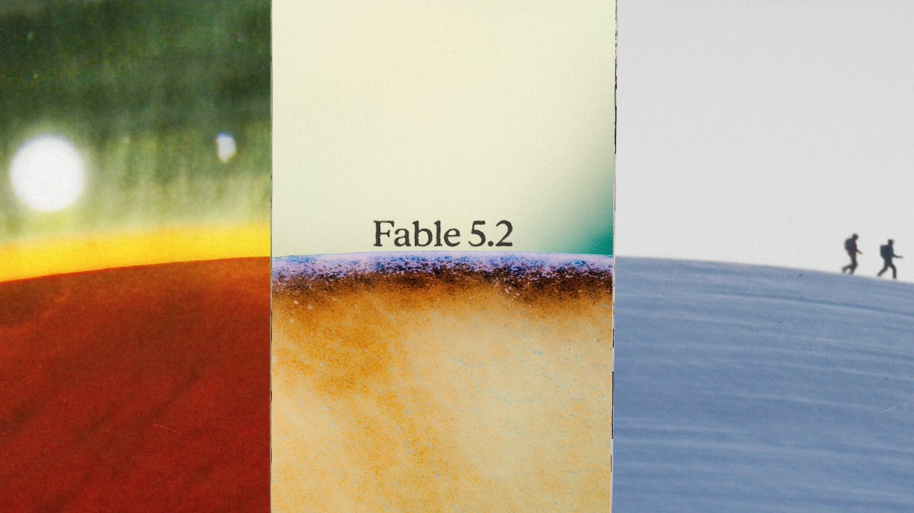

<div align="center">


# Fable 5.2 Motion Archive

**Guides, prompt packs, repo stacks and every video about motion design with Claude Fable 5.2, archived word for word.**


[**▶ Open the website**](https://raw.githack.com/HossamSalemOnline/fable-5.2-motion-design/main/docs/index.html) · [**All repos**](REPOS.md) · [**Sources**](sources/SOURCES.md) · [**Original PDFs**](docs/media/) · [**How entries are added**](HOW-TO-ADD.md)

</div>

---

<!-- AUTO:START (generated by tools/build_site.py; edit sources/entries.json instead) -->

**5 entries · 21 videos · 11 images · 36 unique repos**

## Entries

| | Entry | Type | Author | Date |
|---|---|---|---|---|
|  | **[I haven't opened After Effects in months, these 18 GitHub repos replaced it](content/05-post-18-repos-replaced-after-effects.md)**<br><sub>Rebuild, time, paint, glow, sync, caption: 18 tools from reanimate to FFmpeg, every link expanded, plus the replies.</sub> | Post | [@0xsoul](https://x.com/0xsoul) | 2026-11-22 |
|  | **[20 GitHub repos that turn Fable 5.2 into a video editing studio](content/02-thread-20-github-repos-video-editing.md)**<br><sub>Edit, captions, audio, AI FX and export: 20 open-source repos with every link expanded, plus the replies.</sub> | Post | [@anstapnever](https://x.com/anstapnever) | 2026-11-17 |
|  | **[Motion Design with Fable 5.2: From One Prompt to a Finished Film (Full Course)](content/04-article-seeco-motion-design-full-course.md)**<br><sub>A 20-chapter course: what people built and what it cost, setup, director's briefs, springs and easing, the clock, loops, rendering, motion QA, follow-ups, 3D and Blender, agent teams, budgets, formats, the toolbox, fixes and 4 prompts, with 11 embedded showcase posts.</sub> | Article | [@seeconvm](https://x.com/seeconvm) | 2026-11-16 |
|  | **[Motion Design with Fable 5.2: from zero to your first video in 10 minutes](content/01-article-motion-design-with-fable-5.2.md)**<br><sub>The guide that started this archive: setup in the Claude app or Claude Code, the 6-line director's template, 12 fix-it phrases, vertical video, render.py and 10 beginner mistakes.</sub> | Article | [@anstapnever](https://x.com/anstapnever) | 2026-11-14 |
|  | **[Embedded posts and full prompt packs (One Half, Capybara Onsen)](content/03-embedded-posts-and-prompt-packs.md)**<br><sub>Both PDF prompt packs in full: the 1146-word kids cartoon and 822-word capybara prompts, Fable vs Opus costs, 10 lessons and fill-in templates, plus the original PDFs.</sub> | Prompt packs | [@anstapnever](https://x.com/anstapnever) | 2026-11-13 |

## Watch

| | | |
|:---:|:---:|:---:|
| [](https://raw.githack.com/HossamSalemOnline/fable-5.2-motion-design/main/docs/media/v1-finished-intro.mp4)<br><sub>Finished intro (two messages)</sub> | [](https://raw.githack.com/HossamSalemOnline/fable-5.2-motion-design/main/docs/media/v2-one-line-prompt.mp4)<br><sub>One-line prompt (generic)</sub> | [](https://raw.githack.com/HossamSalemOnline/fable-5.2-motion-design/main/docs/media/v3-directors-template.mp4)<br><sub>Director's template (on brief)</sub> |
| [](https://raw.githack.com/HossamSalemOnline/fable-5.2-motion-design/main/docs/media/v4-side-by-side.mp4)<br><sub>Side by side</sub> | [](https://raw.githack.com/HossamSalemOnline/fable-5.2-motion-design/main/docs/media/v5-after-follow-up.mp4)<br><sub>After one follow-up</sub> | [](https://raw.githack.com/HossamSalemOnline/fable-5.2-motion-design/main/docs/media/v6-vertical-reel.mp4)<br><sub>Vertical Reel (9:16 loop)</sub> |
| [](https://raw.githack.com/HossamSalemOnline/fable-5.2-motion-design/main/docs/media/v7-20-repos-post.mp4)<br><sub>20-repo stack</sub> | [](https://raw.githack.com/HossamSalemOnline/fable-5.2-motion-design/main/docs/media/v8-claude-launch.mp4)<br><sub>Claude Fable 5.2 launch</sub> | [](https://raw.githack.com/HossamSalemOnline/fable-5.2-motion-design/main/docs/media/v9-one-half-cartoon.mp4)<br><sub>"One Half" kids cartoon (3D)</sub> |

<sub>Tap a thumbnail to play it. The full list of 36 repos is in [REPOS.md](REPOS.md).</sub>

<!-- AUTO:END -->

---

## The director's template

The idea both courses agree on: give Fable a brief, not an adjective. From [entry e01](content/01-article-motion-design-with-fable-5.2.md):

```text
Make a [length]-second animated video as one HTML file I can open in Chrome. Everything is drawn in code: no images, no video files. Do it in one go without asking me questions.

WHAT: [what it is and who it's for, one sentence]

SIZE: [1920x1080 for YouTube and X, 1080x1920 for Reels and TikTok], 60 fps. [It plays once and holds the last frame / It loops with no seam.]

LOOK: background [color + hex code], text [color + hex], one accent [color + hex]. Font: [style, e.g. a bold rounded sans-serif from Google Fonts].

TIMELINE:
[0.0-1.0 s]: [what happens]
[1.0-3.0 s]: [what happens]
[...]: [one line per moment, until the end]

MOTION: nothing moves in a straight line at constant speed. Entrances ease out, exits ease in. Every bounce settles within 0.4 s.
```

## Cost reference (API prices, from the authors' session logs)

| Video | Model | Time | Cost | Entry |
|---|---|---|---|---|
| YouTube intro, one line | Fable 5.2 | 6m 56s | $3.65 | e01 |
| YouTube intro, director's template | Fable 5.2 | 2m 22s | $2.81 | e01 |
| Same intro, one follow-up | Fable 5.2 | 3m 21s | $2.39 | e01 |
| Vertical post for Reels | Fable 5.2 | 5m 16s | $3.03 | e01 |
| 30 s kids cartoon in 3D | Fable 5.2 / Opus 5.5 | 11m 11s / 28m 53s | $9.34 / $7.12 | e03 |
| 24 s capybara scene in 3D | Fable 5.2 / Opus 5.5 | 26m 47s / 27m 37s | $11.32 / $6.39 | e03 |

Entry e04 adds a full chapter on effort settings, limits and real bills.

## How this archive works

| | |
|---|---|
| 📚 **Entries** | Each X post or article lives in `content/` as a verbatim Markdown file, with every link expanded and every video and image in place. |
| 🎞 **Media** | Every video, image and PDF is stored in this repo under `docs/media/`. Nothing depends on X staying online. |
| 🧰 **Repo index** | [REPOS.md](REPOS.md) collects every GitHub repo across all entries, so you can see which tools keep coming up. |
| 🌐 **Website** | `docs/` is a designed site with videos playing inline and a copy button on every prompt. |
| ⚙️ **Automation** | On every push, GitHub Actions downloads any new media, switches links to local copies and rebuilds the README, REPOS.md and the website. |

## Repository layout

```text
.
├── README.md                  ← this page (the Entries and Watch sections are generated)
├── REPOS.md                   ← every GitHub repo across all entries (generated)
├── HOW-TO-ADD.md              ← how a new X post becomes an entry
├── content/                   ← one verbatim Markdown file per entry
├── sources/
│   ├── entries.json           ← the list of entries that drives everything
│   ├── media-manifest.json    ← every media file: original URL + Apify backup
│   └── SOURCES.md             ← capture log and original URLs
├── tools/
│   ├── x_article_to_md.py     ← converts a scraped X Article to verbatim Markdown
│   ├── fetch_media.py         ← downloads media into docs/media/
│   ├── build_site.py          ← rebuilds docs/, REPOS.md and the README sections
│   └── render.py              ← the author's HTML-to-MP4 renderer (from e01)
├── .github/workflows/
│   └── fetch-media.yml        ← runs the tools on every push
└── docs/                      ← website + docs/media/
```

---

<div align="center"><sub>All archived content © its original authors. Captured from X for personal reference.</sub></div>
