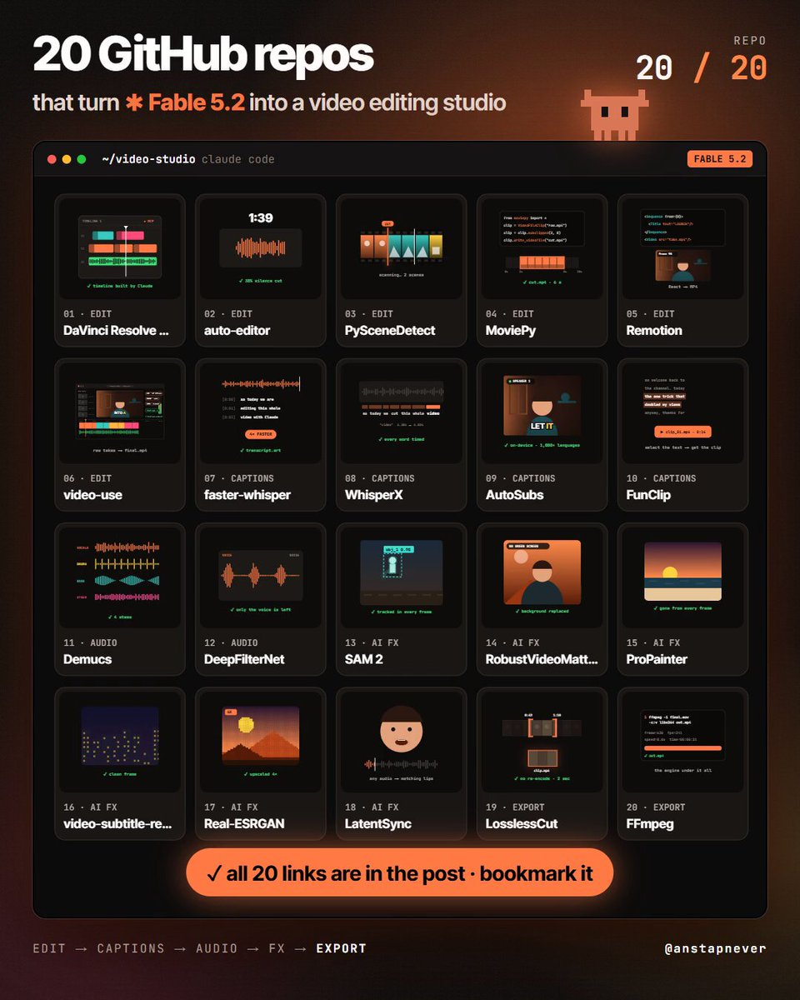

# 20 GitHub repos that turn Fable 5.2 into a full video editing studio

- **Author:** anstap ([@anstapnever](https://x.com/anstapnever))
- **Posted:** Tue 17 Nov 2026, 13:11 UTC
- **Source:** https://x.com/anstapnever/status/2122679111323922521
- **Quotes:** the article [Motion Design with Fable 5.2](01-article-motion-design-with-fable-5.2.md) (https://x.com/anstapnever/status/2121750611691712817)
- **Stats at capture (18 Nov 2026):** 77,451 views · 976 likes · 111 reposts · 5 quotes · 13 replies · 1,952 bookmarks
- **Captured via:** Apify (`xquik/x-tweet-scraper` for the post, `apidojo/tweet-scraper` for replies). All t.co short links expanded to their real GitHub URLs.

## Attached video

 
▶ Video, 21 s, 1080x1350 (4:5) · <a href="../docs/media/v7-20-repos-post.mp4">MP4 1080p</a>

## Full post text (verbatim, links expanded)

this is f*cking gold for Fable 5.2

these 20 GitHub repos will turn your Fable 5.2 into a full Video Editing studio.

edit. captions. audio. AI FX. export.

01 DaVinci Resolve MCP → Claude drives DaVinci Resolve.
https://github.com/samuelgursky/davinci-resolve-mcp

02 auto-editor → Cuts the silence out for you.
https://github.com/WyattBlue/auto-editor

03 PySceneDetect → Finds every scene cut.
https://github.com/Breakthrough/PySceneDetect

04 MoviePy → Video editing in Python.
https://github.com/Zulko/moviepy

05 Remotion → Edit video as React code.
https://github.com/remotion-dev/remotion

06 video-use → Raw footage in, final.mp4 out. Cuts fillers, grades, burns subtitles.
https://github.com/browser-use/video-use

07 faster-whisper → Transcripts, 4x faster than Whisper.
https://github.com/SYSTRAN/faster-whisper

08 WhisperX → Word-level timing for captions.
https://github.com/m-bain/whisperX

09 AutoSubs → Subtitles right inside Resolve and Premiere.
https://github.com/tmoroney/auto-subs

10 FunClip → Cut a video by editing its text.
https://github.com/modelscope/FunClip

11 Demucs → Split vocals, drums and bass.
https://github.com/adefossez/demucs

12 DeepFilterNet → Kills background noise.
https://github.com/Rikorose/DeepFilterNet

13 SAM 2 → Track any object in any video.
https://github.com/facebookresearch/sam2

14 RobustVideoMatting → Green screen without the green screen.
https://github.com/PeterL1n/RobustVideoMatting

15 ProPainter → Erase objects from video.
https://github.com/sczhou/ProPainter

16 video-subtitle-remover → Removes hard-coded subtitles.
https://github.com/YaoFANGUK/video-subtitle-remover

17 Real-ESRGAN → Upscale old footage to 4K.
https://github.com/xinntao/Real-ESRGAN

18 LatentSync → Lip sync to any audio.
https://github.com/bytedance/LatentSync

19 LosslessCut → Trim in seconds, zero re-encode.
https://github.com/mifi/lossless-cut

20 FFmpeg → The engine under every video tool.
https://github.com/FFmpeg/FFmpeg

Raw → cut → captions → sound → final cut.

Bookmark this then go edit something worth watching.

## Quick-reference table

| # | Repo | What it does (author's line) | Stage | Link |
|---|---|---|---|---|
| 01 | DaVinci Resolve MCP | Claude drives DaVinci Resolve | Edit | [samuelgursky/davinci-resolve-mcp](https://github.com/samuelgursky/davinci-resolve-mcp) |
| 02 | auto-editor | Cuts the silence out for you | Edit | [WyattBlue/auto-editor](https://github.com/WyattBlue/auto-editor) |
| 03 | PySceneDetect | Finds every scene cut | Edit | [Breakthrough/PySceneDetect](https://github.com/Breakthrough/PySceneDetect) |
| 04 | MoviePy | Video editing in Python | Edit | [Zulko/moviepy](https://github.com/Zulko/moviepy) |
| 05 | Remotion | Edit video as React code | Edit | [remotion-dev/remotion](https://github.com/remotion-dev/remotion) |
| 06 | video-use | Raw footage in, final.mp4 out. Cuts fillers, grades, burns subtitles | Edit | [browser-use/video-use](https://github.com/browser-use/video-use) |
| 07 | faster-whisper | Transcripts, 4x faster than Whisper | Captions | [SYSTRAN/faster-whisper](https://github.com/SYSTRAN/faster-whisper) |
| 08 | WhisperX | Word-level timing for captions | Captions | [m-bain/whisperX](https://github.com/m-bain/whisperX) |
| 09 | AutoSubs | Subtitles right inside Resolve and Premiere | Captions | [tmoroney/auto-subs](https://github.com/tmoroney/auto-subs) |
| 10 | FunClip | Cut a video by editing its text | Captions | [modelscope/FunClip](https://github.com/modelscope/FunClip) |
| 11 | Demucs | Split vocals, drums and bass | Audio | [adefossez/demucs](https://github.com/adefossez/demucs) |
| 12 | DeepFilterNet | Kills background noise | Audio | [Rikorose/DeepFilterNet](https://github.com/Rikorose/DeepFilterNet) |
| 13 | SAM 2 | Track any object in any video | AI FX | [facebookresearch/sam2](https://github.com/facebookresearch/sam2) |
| 14 | RobustVideoMatting | Green screen without the green screen | AI FX | [PeterL1n/RobustVideoMatting](https://github.com/PeterL1n/RobustVideoMatting) |
| 15 | ProPainter | Erase objects from video | AI FX | [sczhou/ProPainter](https://github.com/sczhou/ProPainter) |
| 16 | video-subtitle-remover | Removes hard-coded subtitles | AI FX | [YaoFANGUK/video-subtitle-remover](https://github.com/YaoFANGUK/video-subtitle-remover) |
| 17 | Real-ESRGAN | Upscale old footage to 4K | AI FX | [xinntao/Real-ESRGAN](https://github.com/xinntao/Real-ESRGAN) |
| 18 | LatentSync | Lip sync to any audio | AI FX | [bytedance/LatentSync](https://github.com/bytedance/LatentSync) |
| 19 | LosslessCut | Trim in seconds, zero re-encode | Export | [mifi/lossless-cut](https://github.com/mifi/lossless-cut) |
| 20 | FFmpeg | The engine under every video tool | Export | [FFmpeg/FFmpeg](https://github.com/FFmpeg/FFmpeg) |

The "Stage" column is my grouping against the post's own "edit. captions. audio. AI FX. export." line; the author did not label each repo.

## Replies captured (9 of 13; the rest were not publicly returned by X)

| Time (UTC) | Author | Reply | Likes | Views |
|---|---|---|---|---|
| 17 Nov 22:36 | [@0xretard_](https://x.com/0xretard_/status/2122821187214692454) | That's an awesome design | 2 | 446 |
| 17 Nov 23:26 | [@cryptowluha](https://x.com/cryptowluha/status/2122833724714668361) | really sick collection, honestly been exclusively using fable 5.2 lately | 1 | 381 |
| 17 Nov 23:45 | [@LeonidaSignal](https://x.com/LeonidaSignal/status/2122838659615408185) | this looks amazing, but how am i supposed to figure this out lol | 0 | 210 |
| 18 Nov 00:21 | [@50xtrade_FX](https://x.com/50xtrade_FX/status/2122847726383895010) | I have already bookmarked it | 1 | 164 |
| 18 Nov 01:14 | [@crypto_ninjas](https://x.com/crypto_ninjas/status/2122861065231081728) | DaVinci Resolve control changes the whole editing workflow completely. | 1 | 366 |
| 18 Nov 02:12 | [@YXxquf](https://x.com/YXxquf/status/2122875643256000590) | The underrated feature in a stack like this is a reversible edit. Keep the source footage untouched and save the edit decisions separately, so "undo that cut" does not become "rerun the entire pipeline." Twenty tools are useful; one reliable way back is essential. | 1 | 211 |
| 18 Nov 05:03 | [@nakaastd](https://x.com/nakaastd/status/2122918654052634790) | crazy ... | 1 | 48 |
| 18 Nov 06:06 | [@kimindiehacker](https://x.com/kimindiehacker/status/2122934326056931482) | those tools are solid, but some may need a learning curve to master | 0 | 60 |
| 18 Nov 06:51 | [@xuemy_](https://x.com/xuemy_/status/2122945839563940207) | 视频工具链先保证剪切确定性和音画同步，再叠视觉效果。 (Translation: a video toolchain should first guarantee cut determinism and audio/video sync, then layer visual effects on top.) | 0 | 34 |

One further item returned by the scraper was an unrelated eToro ad and has been excluded.
