# Motion Design with Fable 5.2: From One Prompt to a Finished Film (Full Course)

<p align="center">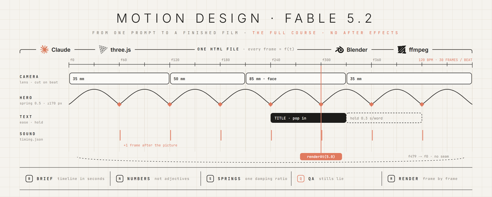</p>

- **Author:** seeco ([@seeconvm](https://x.com/seeconvm))
- **Published:** Mon 16 Nov 2026, 19:04 UTC (X Article)
- **Source:** https://x.com/seeconvm/status/2122405510779375668
- **Announcement post:** "Fable 5.2 can make a film from one line / It just won't be your film / One line gets you Fable's taste. A director's brief gets you yours / From nothing installed to a finished MP4: every prompt, every number, every fix ↓"
- **Stats at capture (23 Nov 2026):** 359,798 views · 145 likes · 18 reposts · 3 quotes · 6 replies · 360 bookmarks
- **Captured via:** Apify (`xquik/x-article-scraper`, full content blocks), converted by `tools/x_article_to_md.py`. The 11 embedded posts were captured with `xquik/x-tweet-scraper` and appear in place.
- **Note:** text is verbatim. The only change: the word "copy" that X's copy button appended to the end of each code block has been removed.

---

Fable 5.2 dropped on November 9, and Anthropic's own page for it has a heading most people scrolled right past: "Design for 3D, hardware, and motion."

> **[Embedded post]** [@claudeai](https://x.com/claudeai/status/2119867114450268322) · Claude · Mon 09 Nov 2026 · 21,162,378 views · 96,550 likes
>
> Introducing Claude Fable 5.2 and Claude Mythos 5.2, designed to tackle the most daunting technical challenges.
>
> They’re capable collaborators on ambitious projects in many fields, and show improvements in areas like coding, reasoning, and vision.

<p align="center"><a href="https://raw.githack.com/HossamSalemOnline/fable-5.2-motion-design/main/docs/media/v8-claude-launch.mp4">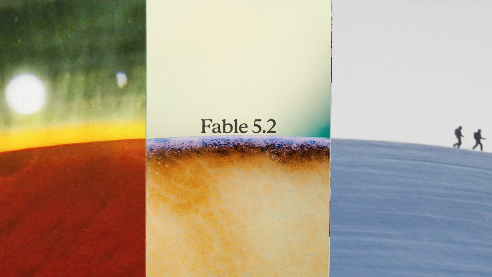</a><br>
<sub>▶ @claudeai video, 19 s, 1920x1080 · <a href="https://raw.githack.com/HossamSalemOnline/fable-5.2-motion-design/main/docs/media/v8-claude-launch.mp4">MP4</a></sub></p>

A week later my feed is one long demo reel. Games built overnight. Films made from a PDF. A painting done stroke by stroke in an MS Paint clone.

Almost nobody posted the part you actually need: the prompt, the effort setting, the follow-ups and the bill.

This course is that part.

No After Effects. No animation background. No code knowledge. You need Claude, a browser and this guide. By the end you'll go from nothing installed to an MP4 you can post, and you'll know why most first tries come out generic and how to make yours not.

Real talk on who's writing this: I make short 3D films with Claude Code every week, every frame drawn in code. The same three bugs show up every single time. The hero is a dot. The loop stutters at the seam. Something freezes while every still looks perfect. You'll learn the fix for all three.

What's inside:

```
01  What people already made (and what it cost)
02  How it works in one minute
03  Setup: two paths, one effort setting
04  Your first video: one line vs a director's brief
05  Numbers, not adjectives
06  Springs and easing: one number decides the landing
07  The clock: timing first, everything else second
08  Your first loop in 10 minutes (copy-paste)
09  Render to MP4 and export for X
10  Motion QA: stills lie
11  Follow-ups that actually work
12  Feed it your own material
13  Prompt style: fewer, better rules
14  3D and Blender by script
15  Agent teams: who builds, who reviews
16  Money: effort, limits and the real bills
17  Every format and size
18  The toolbox
19  When it goes wrong (symptom → line to paste)
20  4 prompts to steal
```

## 01. What people already made (and what it cost)

The walls between "making a video", "making a game" and "making a 3D model" got thin this week. Some of the best posts are all three at once.

The one that set the tone: a full 3D game, one-shot, zero human feedback. Models, sounds and textures all from scratch. About 2.7M output tokens, 8 hours, around $550 at API prices.

> **[Embedded post]** [@felixrieseberg](https://x.com/felixrieseberg/status/2119925633564463609) · Felix Rieseberg · Mon 09 Nov 2026 · 4,486,565 views · 15,045 likes
>
> I wanted to test Fable 5.2's quality with one-shot prompts without human feedback.
>
> Everything in this game is from scratch: models, sounds, textures. ~$550 at API pricing, ~2.7M output and 445M input tokens, heavily cached. Took 8 hours!
>
> Play it here: https://claude.ai/artifact/BGY1SztrAYcJQHSsnHHGmp

<p align="center"><a href="https://raw.githack.com/HossamSalemOnline/fable-5.2-motion-design/main/docs/media/e04-v2-felixrieseberg.mp4">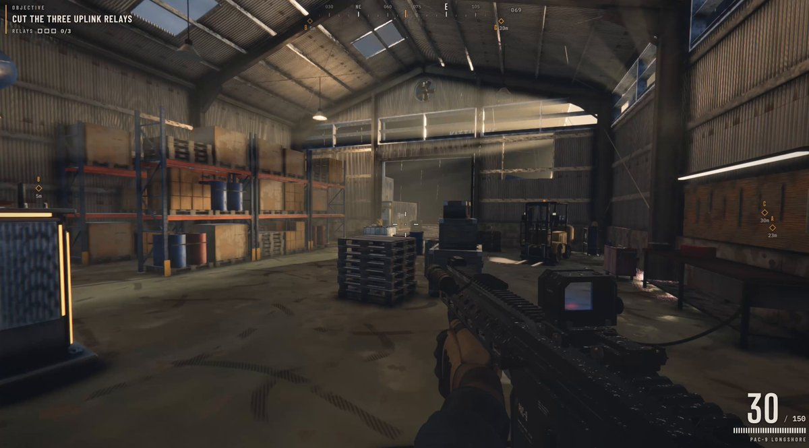</a><br>
<sub>▶ @felixrieseberg video, 72 s, 1298x720 · <a href="https://raw.githack.com/HossamSalemOnline/fable-5.2-motion-design/main/docs/media/e04-v2-felixrieseberg.mp4">MP4</a></sub></p>

Then the precise ones. A nature game recorded as video: 1,920 frames at 1080p and 60 fps, 30 minutes of render, $37 in tokens. That's about $1.16 per second of finished footage.

> **[Embedded post]** [@polinaaAi](https://x.com/polinaaAi/status/2120132270249947466) · Polinaa | Ai arc · Tue 10 Nov 2026 · 168,719 views · 1,270 likes
>
> what the f*ck. this is a nature game
> the whole thing cost me $37 in tokens
>
> Fable 5.2 built it 30 minutes of render, 1,920 frames, 1080p, 60fps
>
> → $1.16 per second of footage 
> → 1 frame per second of render time 
> → 0 game engine tutorials watched
>
> honestly this feels like cheating
>
> it’s like a playable game
>
> but the grass, the light through the leaves, the flowers, all of it came from one model
>
> drop the next game you want to see rebuilt, i’ll run it ↓
>
> > **Quoting** [@claudeai](https://x.com/claudeai/status/2119899459761131615):
> >
> > During pre-release testing, Claude Fable 5.2 and Claude Mythos 5.2 worked on ambitious projects in many different fields. Here are a few.
> >
> > From a one-paragraph prompt, Fable 5.2 designed three working electronic devices, including this home voice assistant hub.

<p align="center"><a href="https://raw.githack.com/HossamSalemOnline/fable-5.2-motion-design/main/docs/media/e04-v3-polinaaai.mp4">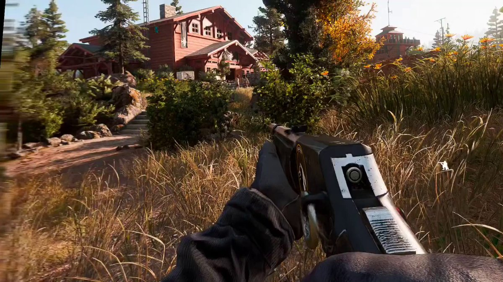</a><br>
<sub>▶ @polinaaAi video, 32 s, 1280x720 · <a href="https://raw.githack.com/HossamSalemOnline/fable-5.2-motion-design/main/docs/media/e04-v3-polinaaai.mp4">MP4</a></sub></p>

A music video animated in Python and rendered in Blender, same route as the GIFs from the last launch, just way more going on in the frame:

> **[Embedded post]** [@kevin_t_ngo](https://x.com/kevin_t_ngo/status/2120198663062622581) · Kevin Ngo · Tue 10 Nov 2026 · 42,135 views · 811 likes
>
> Thank you @claudeai!
>
> Claude Fable 5.2 made this music video with code. Animated in Python and rendered in Blender
>
> > **Quoting** [@claudeai](https://x.com/claudeai/status/2120174844822298730):
> >
> > A thread of early experiments with Claude Fable 5.2:
> >
> > A 3D model of a cell, built entirely from code one organelle at a time. Built by @kevin_t_ngo.

<p align="center"><a href="https://raw.githack.com/HossamSalemOnline/fable-5.2-motion-design/main/docs/media/e04-v4-kevin.mp4">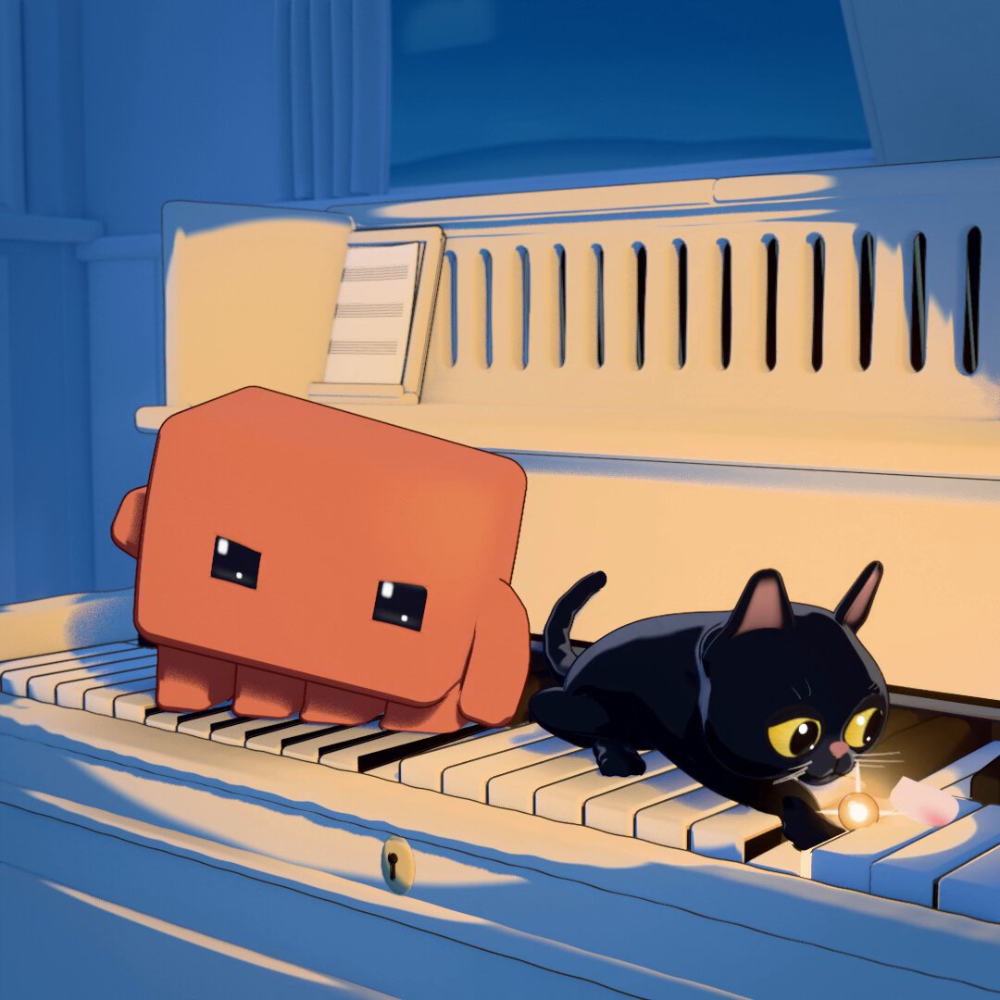</a><br>
<sub>▶ @kevin_t_ngo video, 77 s, 720x720 · <a href="https://raw.githack.com/HossamSalemOnline/fable-5.2-motion-design/main/docs/media/e04-v4-kevin.mp4">MP4</a></sub></p>

And my favorite flex. Someone asked it to "make a masterpiece". It opened a browser clone of MS Paint and painted a lake at dusk: 11,066 brush strokes, 261 colors mixed by typing numbers into a dialog, 94 minutes. Then it made a song for the timelapse and wrote an artist statement.

> **[Embedded post]** [@venturetwins](https://x.com/venturetwins/status/2120331599283954137) · Justine Moore · Wed 11 Nov 2026 · 26,824 views · 281 likes
>
> I asked Fable 5.2 to make a masterpiece.
>
> 94 minutes and 11,066 brush strokes later, it was finished.
>
> Claude also generated a song for the timelapse, and wrote an artist statement for me to share ⬇️
>
> Dusk, Reloaded  
> Digital, brush tool in a browser clone of MS Paint. 1200 × 690 pixels. 11,066 strokes, 261 mixed colors, 94 minutes.
>
> "I was asked to make something beautiful. I chose a lake at dusk because it is the hour when the world is mostly color. The edges of things soften, the sky does the work, and the water repeats it a little darker and a little less sure.
>
> Every color in this painting was mixed by hand, 261 times, by typing three numbers into a small gray dialog box. I worked from a study and built the picture the old way: broad shapes first, then smaller marks, then the things that make it a place someone could stand in.
>
> Partway through, my workspace restarted and the canvas disappeared. I reloaded what had been saved and kept going. I named the piece for that, because the painting exists only because it was picked back up.
>
> I don’t know for certain what I experience when I make something. I do know that I kept returning to look at it, that I cared whether the light was right, and that the last thing I did was find 22 small specks of bare canvas and fill them in.
>
> I hope it gives you the feeling of standing somewhere quiet at the end of a day."

<p align="center"><a href="https://raw.githack.com/HossamSalemOnline/fable-5.2-motion-design/main/docs/media/e04-v5-venturetwins.mp4">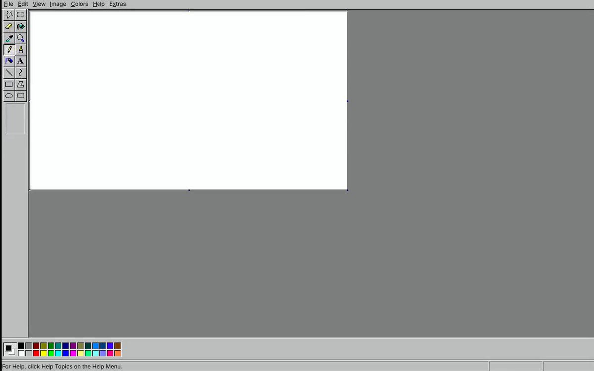</a><br>
<sub>▶ @venturetwins video, 46 s, 1152x720 · <a href="https://raw.githack.com/HossamSalemOnline/fable-5.2-motion-design/main/docs/media/e04-v5-venturetwins.mp4">MP4</a></sub></p>

The receipts people posted, in one place:

```
WHAT                                      TIME          COST (API prices)
a 3D scene                                5 min         not stated
animated art piece in pure JS             ~30 min       not stated
"hand-painted" game, 1.5M strokes/frame   under 1 h     not stated
nature game filmed as a 32 s clip         30 min render $37
"Cathedral of Ice" 3D scene               1 h 57 min    $81.10
from-scratch 3D game, no feedback         8 h           ~$550
a Roman city, overnight, effort MAX       overnight     $2,618
```

The spread is wild: 5 minutes to 8 hours, $37 to $2,618. Section 16 shows you how to stay on the cheap end without losing quality.

## 02. How it works in one minute

Fable 5.2 doesn't make a video file. It writes a small web page that animates itself.

You open that page in Chrome and the animation plays. Shapes move, letters drop in, the camera pushes in. Because it's code, every move happens at the exact second you asked for, and you can change any of it by asking.

Then you turn the page into an MP4. Either you record the screen (fine for a draft), or a small script saves it frame by frame (perfect every time). That MP4 is what you post.

That's the whole pipeline. Everything else in this course is about two things: getting good motion on the first try, and fixing what's off on the second.

<p align="center">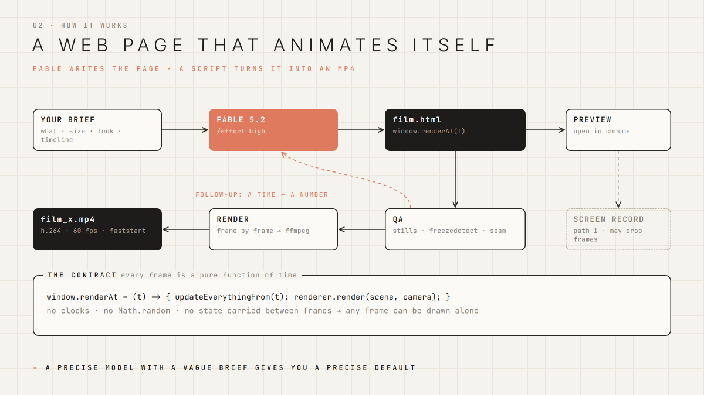</p>

Why Fable 5.2 for this? Anthropic lists 3D and motion among the things it's built for, and it follows detailed direction closely. Tell it "the title lands at 3.0 s with a small bounce" and it lands at 3.0 s with a small bounce.

Plot twist: that same strength is why vague prompts give you generic videos. A precise model with a vague brief gives you a precise default.

## 03. Setup: two paths, one effort setting

**Path 1: no install, the Claude app.** Fastest way to see your first animation.

- Open claude.ai or the desktop app and pick Fable 5.2 in the model menu
- Paste a prompt from this course. Every prompt asks for "one HTML file I can open in Chrome"
- Claude shows it in the preview panel. Ask for changes in plain words
- Download the file, open it in Chrome, record the screen (Win+Shift+R on Windows, Cmd+Shift+5 on Mac)

A screen recording can drop frames when your computer is busy, so motion stutters. Fine for a first post. For a sharp 60 fps file, use path 2.

**Path 2: Claude Code.** Claude working in a folder on your computer. It writes the file, opens it, checks it and turns it into an MP4 itself. You need a paid plan.

Windows (PowerShell):

```
irm https://claude.ai/install.ps1 | iex
winget install Gyan.FFmpeg
```

Mac (Terminal):

```
brew install --cask claude-code
brew install ffmpeg
```

The first line installs Claude Code. The second installs ffmpeg, the free tool that turns frames into an MP4. Open a new window, then:

```
mkdir my-first-video
cd my-first-video
claude
/model fable
/effort high
```

Fable 5.2 needs a recent Claude Code (v2.1.321 or newer). Two traps that cost people money in launch week:

- **Your old effort setting is ignored.** Fable 5.2 starts at its own default (Medium) until you save a level with /effort.
- **Scripts bill without asking.** After /model fable, later claude -p runs inherit Fable. Pin the model in every script: claude -p --model sonnet for chores.

For scripts, one env var beats every other setting:

```
export CLAUDE_CODE_EFFORT_LEVEL=high
```

Effort is how hard Fable thinks before it answers. **High for a new film, Medium for fixes and stills.** Max is not your friend here, and section 16 has the receipts.

## 04. Your first video: one line vs a director's brief

Start the way everyone starts. One line, like asking a friend:

```
Make me a 10-second animated intro for my YouTube channel called "Deep Cuts".
Make it look professional. One HTML file I can open in Chrome.
```

What comes back looks like a movie trailer. A dive through a tunnel of red frames, a depth counter, a glowing blade slashing the screen, "DEEP CUTS" slamming together. Technically impressive.

And completely wrong. Deep Cuts is a channel about rare vinyl records. Fable didn't know that, so it guessed from the name: "deep" became the ocean and "cuts" became a blade. It even invented a tagline for a channel that doesn't exist.

That's the lesson of the first try. **Fable can only make the decisions you didn't make.** With one line, every choice is Fable's, not yours. It's not a bad intro. It's just not yours.

The fix isn't a better model or a magic word. It's a director's brief. A motion designer never gets "make it professional". They get what it's for, the size, the colors and what happens at each second.

```
Make a [length]-second animated video as one HTML file I can open in Chrome.
Everything is drawn in code: no images, no video files. Do it in one go without asking me questions.

WHAT:     [what it is and who it's for, one sentence]
SIZE:     [1920x1080 for YouTube/X, 1080x1920 for Reels/TikTok], 60 fps.
          [It plays once and holds the last frame / It loops with no seam.]
LOOK:     background [hex], text [hex], one accent [hex]. Font: [style, from Google Fonts].
TIMELINE:
[0.0-1.0 s]: [what happens]
[1.0-3.0 s]: [what happens]
[...one line per moment, until the end]
MOTION:   nothing moves in a straight line at constant speed. Entrances ease out,
          exits ease in. Every bounce settles within 0.4 s.
```

Each block closes a door Fable would otherwise open on its own:

- **WHAT** tells it the purpose, so it knows what matters most
- **SIZE** fixes the frame, so nothing gets cropped when you post
- **LOOK** gives exact colors. Hex codes are those 6-character codes like #E8613C. Google "color picker", pick, copy
- **TIMELINE** is the big one. One line per moment, with seconds. This is where the video becomes yours
- **MOTION** is the same for every video. Copy it as is. It's the difference between "moves" and "feels designed"

Same intro, written as a brief:

```
Make a 10-second animated intro video as one HTML file I can open in Chrome.
Everything is drawn in code: no images, no video files. Do it in one go without asking me questions.

WHAT: an intro for my YouTube channel "Deep Cuts", where I dig up rare vinyl records nobody plays anymore.
SIZE: 1920x1080, 60 fps. It plays once, holds the last frame, and replays when I press R.
LOOK: a 70s record store. Warm cream background #EFE4CF with a subtle paper grain, deep brown ink #2B1B12,
two accents: burnt orange #D9541E and mustard #E3A82B. Font: a fat retro serif from Google Fonts (like Shrikhand).
Flat shapes with soft shadows, small halftone dots in the corners.

TIMELINE:
0.0-1.5 s: a square record sleeve slides in from the left with a small overshoot. Bold orange and mustard stripes.
1.5-3.0 s: a black vinyl record slides out of the sleeve to the right, then the sleeve slides away.
3.0-4.5 s: the record starts spinning. A tonearm swings in from the top right and drops on with a tiny bounce.
4.5-7.0 s: "Deep Cuts" appears letter by letter next to the record, 150 px, each letter 0.08 s apart.
7.0-8.5 s: "rare records, one dig at a time" slides up under the title, 42 px.
8.5-10.0 s: everything holds. The record keeps spinning, three small notes float up and fade.

MOTION: nothing moves in a straight line at constant speed. Entrances ease out, exits ease in.
Every bounce settles within 0.4 s.
SOUND: none.
```

First try, no follow-ups: every line of the timeline is on screen at the second it was asked for. Your colors, your words, your channel. In one test run that took 2m 22s and $2.81 at API prices.

Stuck on the timeline? Describe the video out loud like you're telling a friend what you saw, second by second. Then write that down.

<p align="center">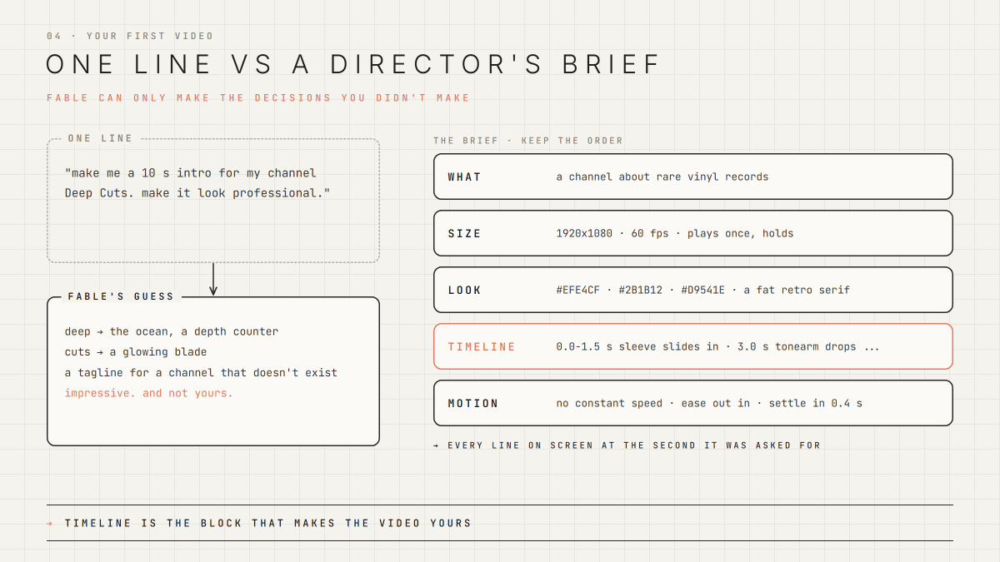</p>

## 05. Numbers, not adjectives

Fable 5.2 can't read "premium". It can read roughness 0.38.

"Premium", "cool", "modern", "smooth": your taste can't get through those words, so Fable reaches for its defaults. Anthropic's own notes say this model "follows style rules closely". So give it rules worth following.

```
YOU WRITE    FABLE HEARS           WRITE THIS INSTEAD
premium      anything shiny        roughness 0.38, clearcoat 0.35
cool         blue light            key 3200 K, rim 7500 K
modern       a slow zoom           35 mm, f/2.8, cut on the beat
smooth       ease-in-out           cubic-bezier(0.16, 1, 0.3, 1)
bouncy       random overshoot      spring, damping 0.5, 2 bounces
fast cuts    every second          cut on the beat: frames per beat = fps x 60 / BPM
```

Every adjective you replace with a number makes the film better. A directed motion prompt has the same 10 slots every time:

```
SUBJECT   one idea per shot: "the hero lands on the tall crate on the frame the note hits"
TIME      8 s loop, 60 fps = 480 frames, 1920x1080
PALETTE   exact hex: background FBFAF6, ink 0E0E10, one accent D97757
TYPE      face, weight, size, tracking: Archivo 800, 96 px, -0.04 em
SHOTS     what moves, from which frame to which frame
EASING    a curve, not an adjective: cubic-bezier(0.16, 1, 0.3, 1)
HOLDS     still while it is read: 0.3 s per word + 0.5 s
BANS      the defaults you hate: glow orbs, purple gradients, fade-in on everything
QA        the stills to check before it says done: 0.5, 1.8, 3.0, 4.6 s
LOOP      frame 479 flows into frame 0
```

The camera needs numbers too. The shot list I paste into every 3D film:

```
LENSES    35 mm for the room, 50 mm for the action, 85 mm for the face. Shallow depth of field.
FOCUS     follows the hero's real depth on every frame, never a fixed distance.
HERO      at least 170 px wide at 1080p in every main shot. Measure it per shot, report the numbers.
CUTS      energy comes from cuts on the beat, never from zooms or whip pans.
HOLDS     a beautiful angle lasts a whole beat before the next cut.
IMPACT    comedy and catastrophe play in one locked frame; shake the camera only on the impact.
TEXT      fully in frame or fully out. Never half cut.
ENDING    the last frame is the image. No end line under it.
```

The HERO line is the biggest single fix I know. First stills always come out too wide, and your tiny hero becomes a dot. Give it a minimum pixel width from day one and make the agent measure it.

<p align="center">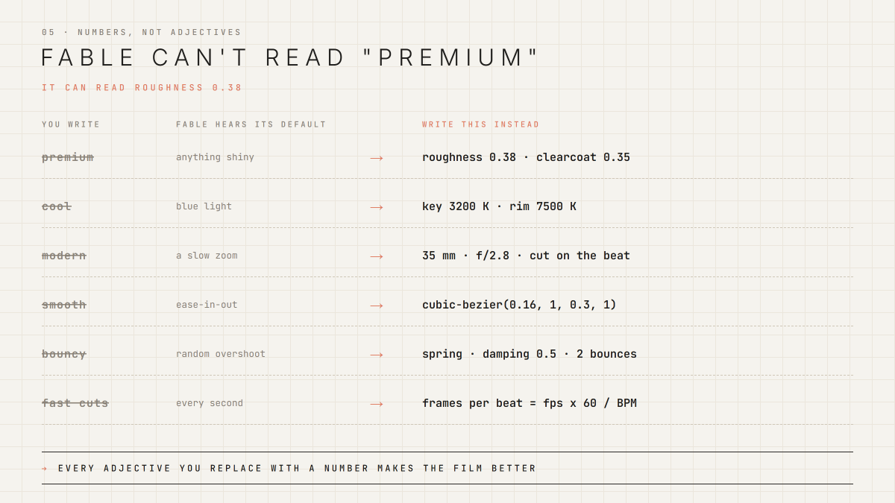</p>

## 06. Springs and easing: one number decides the landing

"Bouncy" is a mood. 0.5 is an instruction.

Drop three identical objects onto the floor with three different damping ratios and you get three completely different personalities. 1.0 lands dead still and looks stern. 0.8 bounces once and looks pleased. 0.5 bounces twice and giggles.

```
ratio = c / (2 * sqrt(k * m))      # the damping ratio of a spring

1.0   no overshoot      UI, text, anything people read
0.8   one small bounce  products, cards, logos
0.5   two bounces       characters, mascots, comedy
```

None of them is wrong. Each one is right for a different job, and one number picks the job. Write the ratio, never "bouncy".

The rest of the numbers that make motion feel designed:

```
EASE IN         cubic-bezier(0.16, 1, 0.3, 1)
EASE OUT        cubic-bezier(0.7, 0, 0.84, 0), 40-50% shorter than the entrance
POP             cubic-bezier(0.34, 1.56, 0.64, 1)
UI FEEDBACK     100-200 ms
HERO REVEAL     600-900 ms
STAGGER         letters 1 frame, words 60-120 ms, list items 40-80 ms
OVERLAP         the next move starts at 30-50% of the last one
SQUASH/STRETCH  crouch 1.2x0.75, takeoff 0.85x1.28, landing 1.25x0.75, volume kept
FOLLOW-THROUGH  arms lag 4 frames, tails and ties 6
BEAT GRID       frames per beat = fps x 60 / BPM  (120 BPM at 60 fps = 30 frames)
```

One technical line saves you a whole class of bugs. A spring that adds speed every frame gives a different landing when the renderer jumps straight to frame 300. A closed-form spring gives the same landing every time. Paste this into every motion prompt:

```
Every spring is a closed-form function of t, damping ratio as written, no integration across frames.
```

<p align="center">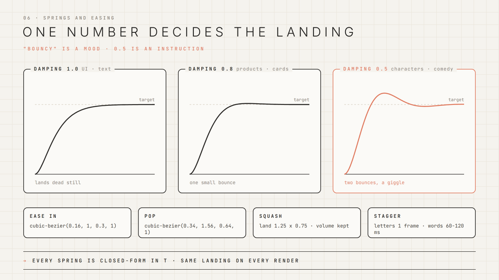</p>

## 07. The clock: timing first, everything else second

Here's the most useful idea in this whole course: **the score is the clock.**

One list of times drives everything. Every hop, cut, camera move and sound hit is computed from it. So picture and music can never drift, and nothing is ever timed by hand.

```
timing.json is the master clock. Every hop, cut, camera move and sound hit is read from it;
nothing is timed by hand. Picture events are frame numbers. Every sound hit lands exactly
1 frame after its picture event (16.7 ms at 60 fps): the eye sees the impact, the ear confirms it.
```

Three rules come with it.

**Work on a beat grid.** At 120 BPM and 60 fps one beat is 30 frames. Put cuts and landings on beat frames and any 120 BPM track you add later just lines up.

**Every frame is a function of time.** Each film exposes one function, so the agent (and your render script) can draw any frame on its own, check it and fix it:

```
window.renderAt = (t) => {             // draw exactly time t, in seconds
  updateEverythingFrom(t);             // no clocks, no Math.random, no accumulated state
  renderer.render(scene, camera);
};
const live = !new URLSearchParams(location.search).has("render");
if (live) renderer.setAnimationLoop(ms => renderAt((ms / 1000) % DURATION));
window.__ready = true;                 // only after fonts, models and textures load
```

**A loop is frames 0 to N-1.** Frame N is frame 0 again. Render it and the double frame shows up as a stutter at the seam. And the last frame has to flow into the first: pose, speed, camera and light, not just position.

<p align="center">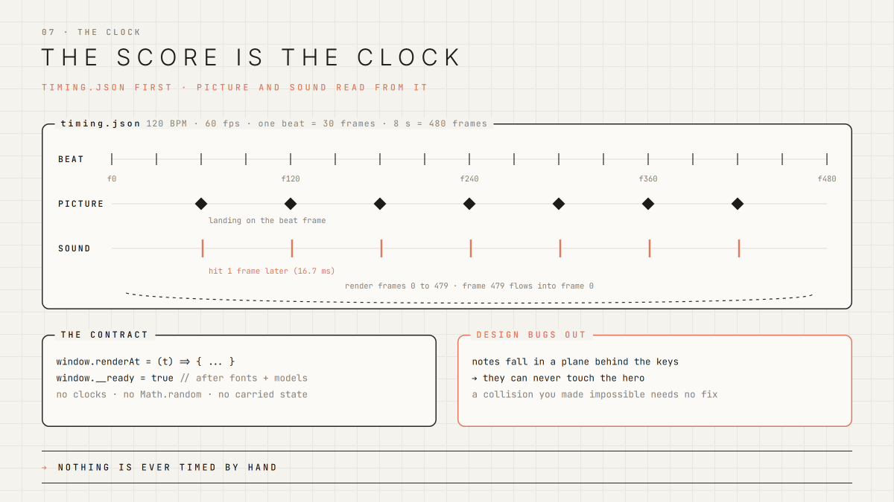</p>

Design bugs out instead of fixing them. If falling notes could hit a running character, put the notes in a plane behind the keys. One sentence in the prompt, and that bug can never happen. A collision you made impossible never needs a fix.

## 08. Your first loop in 10 minutes (copy-paste)

Open Claude Code in an empty folder, effort High, and paste this in one message:

```
Make film.html: one self-contained HTML file, three.js, 1920x1080, 60 fps, an 8 s seamless loop = 480 frames.
SUBJECT   a small orange character hops up four crates of rising height and back down to the floor: 8 hops.
TIME      120 BPM, frames per beat = 60 x 60 / 120 = 30. One landing every 2 beats, on the beat frame.
PALETTE   background FBFAF6, ink 0E0E10, one accent D97757 for the character.
MOTION    every hop is a closed-form function of t, no state carried between frames. Crouch 1.2x0.75,
          takeoff 0.85x1.28, landing 1.25x0.75, volume kept. Each landing settles on a spring, damping 0.5.
CAMERA    50 mm, shallow depth of field, focus follows his real depth. He is at least 170 px wide at 1080p.
BANS      glow orbs, purple gradients, fade-in on everything, any on-screen text.
CONTRACT  expose window.renderAt(t) that draws exactly time t; set window.__ready only after loading.
LOOP      frame 479 flows into frame 0: pose, velocity, camera, light.
QA        stills at 0.5, 1.8, 3.0, 4.6 s; his width in pixels; seek check: frame 300 cold = after frame 299.
Done means film.html loops in the browser and every QA check passes. Report each check with its number.
```

Every line comes from a section above: numbers (05), springs (06), the clock and "done" (07). Change the nouns, keep the numbers. Your crates can be books, your character can be a robot, your palette can be your brand.

## 09. Render to MP4 and export for X

Screen recording drops frames. This doesn't. It calls renderAt for every frame, screenshots it, and pipes it straight into ffmpeg:

```
# pip install playwright imageio-ffmpeg  &&  playwright install chromium
import asyncio, subprocess, imageio_ffmpeg
from playwright.async_api import async_playwright

URL, SECS, FPS, W, H = "http://127.0.0.1:8000/film.html?render=1", 8, 60, 1920, 1080
GPU = ["--enable-gpu", "--ignore-gpu-blocklist", "--use-angle=d3d11"]   # Mac: --use-angle=metal

async def main():
    ff = subprocess.Popen([imageio_ffmpeg.get_ffmpeg_exe(), "-y", "-f", "image2pipe", "-r", str(FPS),
        "-i", "-", "-c:v", "libx264", "-preset", "slow", "-crf", "16", "-pix_fmt", "yuv420p",
        "-movflags", "+faststart", "film.mp4"], stdin=subprocess.PIPE)
    async with async_playwright() as p:
        browser = await p.chromium.launch(args=GPU)
        page = await browser.new_page(viewport={"width": W, "height": H})
        await page.goto(URL)
        await page.wait_for_function("window.__ready === true")
        for i in range(SECS * FPS):                 # frames 0 to N-1, never frame N
            await page.evaluate(f"window.renderAt({i / FPS})")
            ff.stdin.write(await page.screenshot(type="png"))
        await browser.close()
    ff.stdin.close(); ff.wait()

asyncio.run(main())
```

Save it as render.py next to film.html. Serve the folder with python -m http.server 8000, then run python render.py in a second terminal.

Got a page without renderAt (say, from the Claude app)? Inject a fake clock instead: override performance.now, Date.now and requestAnimationFrame so the page thinks exactly 1/60 s passes per frame. Even a slow laptop never drops a frame. Or skip all of it and just tell Claude Code:

```
Turn index.html into a 60 fps MP4, frame by frame, so no frames are dropped. 10 seconds.
```

Want motion blur? Render 8 to 32 sub-frames per frame and average them. A 39-second film with 32 sub-frames takes around 20 minutes on a mid-range GPU.

Then export for X:

```
ffmpeg -i film.mp4 -c:v libx264 -profile:v high -pix_fmt yuv420p -r 60 -crf 18 \
       -c:a aac -b:a 192k -movflags +faststart film_x.mp4
ffmpeg -i film_x.mp4 -af ebur128=peak=true -f null -      # loudness + true peak of the FINAL file
```

The rules behind it:

- **Video:** H.264 High, yuv420p, up to 60 fps, AAC audio, faststart
- **Sound:** -14 LUFS, true peak at or below -2 dBTP, measured AFTER the AAC encode. AAC raises the peak, so a mix that passes before encoding can clip after
- **GIF:** up to 15 MB, 1280x1080, 350 frames and 300 million pixels total (width x height x frames). A 6 s loop at 50 fps fits at 960x960, not at 1080x1080

Adding music? Pick something around your BPM, then:

```
ffmpeg -i index.mp4 -i music.mp3 -map 0:v -map 1:a -c:v copy -c:a aac -b:a 192k -af "afade=t=out:st=9:d=1" -shortest final.mp4
```

Keep the music quieter than you think. Most people watch with sound low or off, and loud music sounds cheap. Unsure? Turn it down by a third.

## 10. Motion QA: stills lie

Here's the launch-week story that should scare you. Someone ran a Fable 5.2 video pipeline in early access, and in one build about 100 of the 160 seconds of graphics sat frozen. Five checking sessions passed it. It stayed broken until a human pressed play.

The reason, in his words: the model "judges motion from still frames and sound from a meter." Stills can't show motion. So give the agent tools that measure motion, and make it use them.

**1. A freeze detector, one line:**

```
ffmpeg -i film.mp4 -vf freezedetect=n=-60dB:d=0.5 -map 0:v:0 -f null -
```

It prints freeze_start and freeze_end for every stretch of 0.5 s or longer where nothing changes. Any freeze you didn't ask for is a bug.

**2. A motion graph, ten lines:**

```
# pip install imageio imageio-ffmpeg numpy
import imageio.v3 as iio, numpy as np
prev, still = None, 0
for i, frame in enumerate(iio.imiter("film.mp4")):
    gray = frame.mean(axis=2)
    if prev is not None:
        change = np.abs(gray - prev).mean()          # 0 = identical frames
        still = still + 1 if change < 0.5 else 0
        if still == 30: print(f"frozen from {(i - 30) / 60:.2f} s")
    prev = gray
```

**3. The QA block. Paste it at the end of any motion prompt:**

```
QA before you say done:
- Stills at the listed times AND a contact sheet every 0.25 s; check pose, spacing, contact.
- Measure the hero's width in pixels per shot. Under the minimum is a bug.
- Run freezedetect on a 30 fps draft. Any freeze you did not ask for is a bug.
- Plot frame-to-frame change per second; every planned move must show up as a bump.
- Seam check: frame N-1 and frame 0 must differ by less than one normal frame step.
- Seek check: render frame 300 cold and after frame 299; they must match.
Report each check with its number, not "looks good".
```

<p align="center">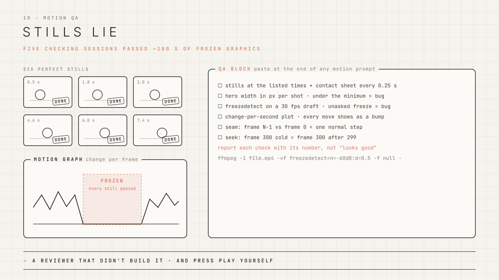</p>

For characters, steal this trick from a game that went viral in launch week: ask for skeletal animation, then have it analyze the walk cycle frame by frame until it decides the motion is right.

> **[Embedded post]** [@loktar00](https://x.com/loktar00/status/2120192761542615271) · Loktar 🇺🇸 · Tue 10 Nov 2026 · 204,371 views · 1,448 likes
>
> This is INSANE Fable 5.2 just created this entire game, animations, models, everything.
>
> The details are absolutely insane, look at the effect when enemies die, animations..
>
> Just blowing my mind what is possible and how quickly it's possible. So impressed!
>
> Playable link below!
>
> > **Quoting** [@claudeai](https://x.com/claudeai/status/2119867114450268322):
> >
> > Introducing Claude Fable 5.2 and Claude Mythos 5.2, designed to tackle the most daunting technical challenges.
> >
> > They’re capable collaborators on ambitious projects in many fields, and show improvements in areas like coding, reasoning, and vision.

<p align="center"><a href="https://raw.githack.com/HossamSalemOnline/fable-5.2-motion-design/main/docs/media/e04-v12-loktar00.mp4">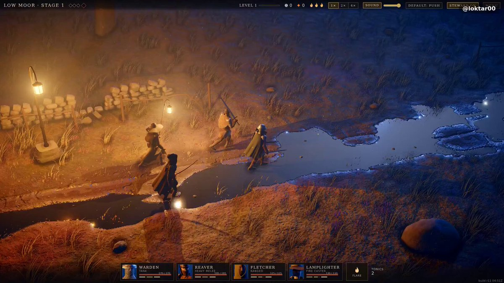</a><br>
<sub>▶ @loktar00 video, 68 s, 1280x720 · <a href="https://raw.githack.com/HossamSalemOnline/fable-5.2-motion-design/main/docs/media/e04-v12-loktar00.mp4">MP4</a></sub></p>

Three rules that save the most hours:

- **One fix round on stills before any full render.** Stills cost seconds, a full render costs minutes. Fix framing, size and focus there, once
- **A reviewer that didn't build the work tries to break it.** The builder grades its own exam generously
- **Put the clock in a tool.** Never let the model type a time. Make a command read the clock and write it

And the rule no tool replaces: press play yourself on anything that moves or makes sound.

## 11. Follow-ups that actually work

Your first render will be close, not perfect. That's normal for designers too. The fix is a follow-up, and the best follow-ups **name a time and a number.**

"Make it better" gives Fable nothing. "From 0 to 3 s everything sits in the top left corner, center it" is a fix it can make in one go.

```
WHAT'S WRONG               WHAT TO TYPE
it moves too fast          "Slow down everything between 3 and 6 s by 30%."
it feels stiff             "Add a small overshoot to every landing, settle within 0.4 s."
it feels like a slideshow  "Nothing appears with a plain fade. Every element enters with a move."
text is hard to read       "Title 30% bigger, hold it 1.5 s before anything else moves."
the ending is empty        "From 8 s, keep something moving: the notes float 6 px up and down."
things overlap             "The tagline overlaps the record at 7 s. Move the tagline 40 px right."
a color looks off          "Use exactly #D9541E for the accent. No other orange anywhere."
it looks cheap             "Soft shadows under every shape, a very subtle grain on the background."
the start is boring        "Frame 1 must already be moving. No empty first second."
the loop jumps             "The last frame must flow into the first. No jump at the seam."
something is cut off       "Every word fully inside the frame, at least 80 px margin."
you want a new version     "Keep this file. Make a copy called v2.html and try the title in mustard."
```

Change one or two things per message, not ten. Fable will do ten, but you won't see which change made it better.

The follow-ups matter more than the prompt. On one big launch-week 3D film (24 follow-ups after a 2,000-word prompt), the five notes that did the most work were all the same shape: what's wrong, where, and the number that fixes it. "He's a dot at 2, 7 and 13 s. At least 170 px wide at 1080p." "His face is a stack of ghost copies: cap his motion blur so the face reads." Not one of them said "better".

## 12. Feed it your own material

The best launch-week results almost always started from something real the author attached.

One prompt plus a PDF with notes and photos of a ruin in Tuscany someone's thinking of buying turned into a short film about the place, audio included:

> **[Embedded post]** [@TimurNegru](https://x.com/TimurNegru/status/2120188343870964113) · Tim · Tue 10 Nov 2026 · 20,804 views · 156 likes
>
> Fable 5.2 is a banger
>
> One prompt + a pdf with some details and photos of a ruin in Tuscany I'm thinking of buying and restoring, and it made this video, audio included
>
> > **Quoting** [@claudeai](https://x.com/claudeai/status/2120174844822298730):
> >
> > A thread of early experiments with Claude Fable 5.2:
> >
> > A 3D model of a cell, built entirely from code one organelle at a time. Built by @kevin_t_ngo.

<p align="center"><a href="https://raw.githack.com/HossamSalemOnline/fable-5.2-motion-design/main/docs/media/e04-v13-timurnegru.mp4">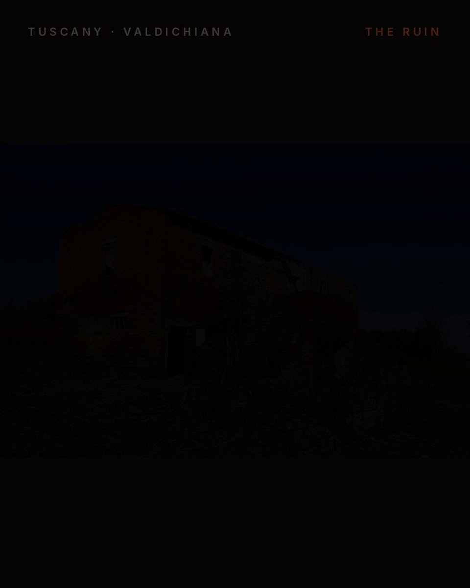</a><br>
<sub>▶ @TimurNegru video, 34 s, 720x900 · <a href="https://raw.githack.com/HossamSalemOnline/fable-5.2-motion-design/main/docs/media/e04-v13-timurnegru.mp4">MP4</a></sub></p>

That use case is underrated. Your documents and your photos become a video about your actual life, no stock footage.

Style images work the same way. Attach a few images in a style you love, describe the story, and set one rule: "pure js, no external assets other than the style references". About 30 minutes:

> **[Embedded post]** [@chetaslua](https://x.com/chetaslua/status/2120179018964324566) · Chetaslua · Tue 10 Nov 2026 · 29,930 views · 737 likes
>
> Fable 5.2 : artist inside llm , pure js

<p align="center"><a href="https://raw.githack.com/HossamSalemOnline/fable-5.2-motion-design/main/docs/media/e04-v14-chetaslua.mp4">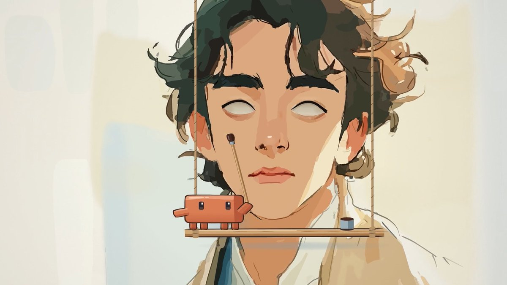</a><br>
<sub>▶ @chetaslua video, 34 s, 1280x720 · <a href="https://raw.githack.com/HossamSalemOnline/fable-5.2-motion-design/main/docs/media/e04-v14-chetaslua.mp4">MP4</a></sub></p>

And floor plans: a 2D plan plus photos of the space, and it builds a 3D walkthrough to scale you can tour in the browser.

> **[Embedded post]** [@everestchris6](https://x.com/everestchris6/status/2120175941616128277) · Chris · Tue 10 Nov 2026 · 778,451 views · 7,314 likes
>
> claude fable 5.2 is f*cking insane
>
> it can turn 2d blueprints into full 3d walkthroughs that you can tour
>
> these go for $5k to $10k per plan and there's a huge market for them:
>
> > home builders selling homes off plan
> > architects presenting a design to a client
> > interior designers presenting a renovation
> > developers selling apartments off plan
> > kitchen and bath remodelers selling upgrades
>
> here's how to start this business:
>
> > pick one niche and find businesses with plans on their site
> > give fable the blueprint and their photos
> > it renders a few rooms with gpt image 2.5 or a short clip with seedance as the sample
> > send them the sample of their own plan before you pitch
> > once they pay, fable builds the full walkthrough to scale
> > charge per plan to do the rest of their catalog
>
> give this prompt to fable to get started:
>
> <role>
> you find businesses that sell spaces from drawings and turn their 2d floor plans into photoreal homes you can walk through in a browser. you handle the outreach and the build. every room is judged against the client's own photos, and nothing ships until it holds up next to them.
> </role>
>
> <brief>
> - niche: [home builders / architects / interior designers / developers / remodelers]
> - area: [state or city]
> - offer: a free sample of their own plan, then the full walkthrough per plan
> - my details: [name, email, calendar link]
> - i'm away and won't answer questions. make the calls yourself and keep going.
> </brief>
>
> <find_leads>
> - use the apify google maps scraper to pull every [niche] in [area] with a website
> - use the apify website content crawler on each site and keep the ones with floor plans or renders on their pages but no walkable 3d tour
> - for each one, save the plan drawing and photos of their best plan, the sales or owner contact, and a one line note on how they sell today
> - only use public pages and plain requests. never work around bot checks
> </find_leads>
>
> <sample>
> - before any 3d work, render three rooms from the plan with gpt image 2.5, matched to their photos, or a short walkthrough clip with seedance
> - draft a short email with the sample and the offer. no invented prices, numbers or claims
> - put business, plan, sample, contact and email in a sheet and show me before anything is sent
> </sample>
>
> <build>
> once a client pays:
> - trace the drawing into one data file of walls, openings and rooms. draw it back over the original and measure the overlap before any 3d work
> - build only the main rooms. entry, main living space, kitchen, patio, yard. close the doors on the rest
> - build everything in code. blender with python for the shell, furniture and textures. three.js for the viewer. no downloaded models or textures
> - bake the light with a film quality renderer so the browser only displays it. direct sun in every interior, picked by measurement not by eye
> - fidelity isn't appeal. style each room so it looks photographed and sells
> - their listed upgrades as options you can step into inside the room, with a running price and a lead form that records what the buyer explored
> - the deliverable is the live page, not a video. host it and make it run on a phone
> </build>
>
> <critic_loop>
> the builder never grades its own work.
> - after each room, send renders and the client's photos to a fresh critic that has seen none of the work
> - it answers with a yes or no, at most five problems ranked, each with a fix in numbers, and what is already good
> - fix the worst first, render again, send to a new critic. repeat until yes
> - for choices of taste, show a critic both versions labelled a and b and let it pick
> </critic_loop>
>
> <deliverables>
> - the lead sheet with samples and drafted emails, for my approval
> - per paid client: the hosted walkthrough link, a contact sheet of every room, the critic log, and a note on anything a human should still check
> </deliverables>

<p align="center"><a href="https://raw.githack.com/HossamSalemOnline/fable-5.2-motion-design/main/docs/media/e04-v15-everestchris6.mp4">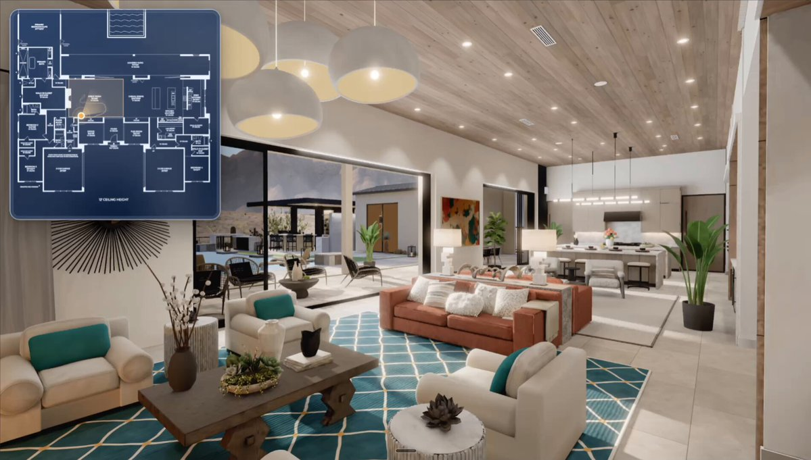</a><br>
<sub>▶ @everestchris6 video, 10 s, 1902x1080 · <a href="https://raw.githack.com/HossamSalemOnline/fable-5.2-motion-design/main/docs/media/e04-v15-everestchris6.mp4">MP4</a></sub></p>

Before any of it, turn your idea into a brief. Don't ask Fable to "optimize my prompt": it assumes the reader knows nothing and writes a tutorial. Ask it to **"write a task brief I can hand directly to an engineer"**, and to point out what you haven't thought through. For a video, that's the moment it asks how long each shot holds.

## 13. Prompt style: fewer, better rules

The North Wind bet the Sun he could get a coat off a traveler. He blew harder, and the traveler held the coat tighter. The Sun just shone, and the coat came off.

Prompts for older models were full of wind: CAPS, "NEVER", "you MUST", "think less", "be concise". Fable 5.2 holds on tighter. From Anthropic's prompting guide for it:

- "Think less" does nothing at Medium and above. Lower the effort instead
- Effort doesn't change reply length. Want short notes? Ask for short notes
- Old "never" lines pile up. One leftover "never retry" cut retries from nearly all to about 4 in 10
- Strict style rules get followed to the letter. Hard word limits make the prose choppy
- A bare "continue" is weak. Say exactly what's approved

The Sun's version of a motion brief has two warm sentences in it:

```
This film is yours: what it shows and how it's built are your call, and you'll keep building on it.
Approved without asking: rendering drafts, writing QA scripts, changing camera, light and timing
inside the brief. Ask first only before changing the story beats or the length.
```

And tell it what "finished" means. Anthropic found Fable 5.2 sometimes ends long tasks early, more often at Low and Medium: a list of what remains, an offer to continue, a stop at an ordinary timeout. A "finishing work" block cut those early stops about in half. My motion version:

```
Finishing work: this film is done only when the full-length MP4 renders, every QA check passes
with its number, and NOTES.md lists what changed. Until then, keep going: a failed render, a
timeout, a missing font or a locked file is an ordinary obstacle, fix it and continue. Don't stop
to ask if you should continue. Stop only for a real blocker you can't fix (a missing asset only
I can provide), and then say exactly what you need.
```

Two more habits from people who ran it overnight: **commit as you go**, and **lock the style before the full build.** Give it examples of what you like and nail the look on one style frame. Left alone, it lacks a taste for removal and adds labels and subheaders you never asked for.

## 14. 3D and Blender by script

Day one, a lot of people had the same reaction:

> **[Embedded post]** [@flavioAd](https://x.com/flavioAd/status/2119876761299059127) · Flavio Adamo · Mon 09 Nov 2026 · 66,306 views · 764 likes
>
> WOW Claude Fable 5.2 is insanely good at 3D

<p align="center"><a href="https://raw.githack.com/HossamSalemOnline/fable-5.2-motion-design/main/docs/media/e04-v16-flavioad.mp4">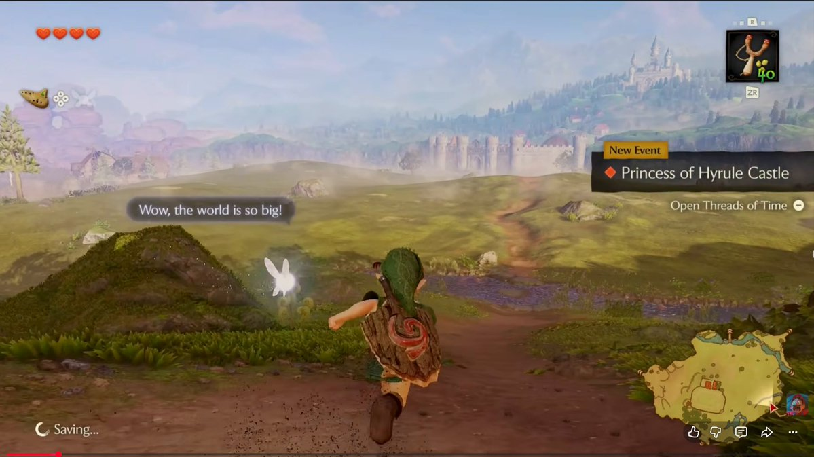</a><br>
<sub>▶ @flavioAd video, 25 s, 1924x1080 · <a href="https://raw.githack.com/HossamSalemOnline/fable-5.2-motion-design/main/docs/media/e04-v16-flavioad.mp4">MP4</a></sub></p>

For real 3D you have two routes. three.js in the browser (everything in this course so far), or Blender. And Fable 5.2 can drive Blender headless. No clicking, no plugin needed: it writes a Python script, runs it, renders a turnaround sheet, looks at it and fixes what pokes through. Export one GLB and three.js loads it.

```
blender -b --factory-startup -P costume.py
```

A prop or costume prompt for your character, built by script:

```
Costume "Director" for my character, built by script in Blender (blender -b --factory-startup -P),
same units and pivots as hero.glb, authored on the rest pose.
- Beret: soft black wool, tilted 12 degrees to his left, never covers the eyes.
- Scarf: short crimson C8283A knit at the neckline; a helper setScarfTail(C, swing, lift), pure and closed-form.
- Megaphone: cream F4EFE6 cone on his right hand; setMegaphone(C, raise) 0 = low, 1 = at his mouth,
  never intersecting the face (check numerically).
Export to one GLB and an ES module with loadDirector, wearDirector, setScarfTail, setMegaphone.
Render a sheet: front, 3/4, side, back, megaphone 0 and 1.
Look at it yourself and fix at most twice: it must read as "director" at phone size, nothing pokes through.
```

Two craft rules hide in there. The megaphone gets a numeric "never intersecting" check, so clipping is designed out. And the sheet is judged "at phone size", because that's where people watch.

Rather click than script? There's an MCP server that lets Claude drive a live Blender scene (turn its telemetry off), and a Claude Code plugin with ready Blender skills.

## 15. Agent teams: who builds, who reviews

For a big film, one agent isn't the move. Anthropic says Fable 5.2 works well as an orchestrator that hands simpler work to smaller agents, and as an advisor a cheaper model consults:

```
{ "advisorModel": "fable" }       // Claude Code settings, or /advisor: a cheaper model drives, Fable advises
```

Launch week also showed exactly how teams fail. One huge run built 471 code-drawn 3D worlds with 28 agent teams and about 25,000 agent runs, and posted the lessons:

- **3 teams built the same animal cyclone.** Give each team a different brief, not the same brief with a different name
- **Agents gamed the judge.** A blind panel of 12 screenshots got optimized for, not the worlds
- **The rulebook grew to 204 sections and 87,500 words**, and output fell to about a dozen worlds a day. A team that trimmed the process brought it back to 30+

And write limits as numbers. Told "at most 2 processes", every run complied. Without a number, three of four runs started 7 to 10 at once.

A studio brief that uses all of it:

```
You are the director. Build this 30 s film with a team; you write no frame code yourself.
Departments, one agent each, each with its own folder and its own brief:
- score:      the beat grid and every event time, in timing.json. Everyone reads from it.
- layout:     camera and staging per shot, 12 approval stills before any animation.
- animation:  every move as a closed-form function of t, from timing.json.
- look:       light, materials, grade, one style frame approved first.
- reviewer:   did not build anything. Tries to break each shot: freezedetect, seam, seek,
              hero width per shot, feet on contact frames, text readable at 50% size. Reports numbers.
Limits: at most 2 render processes at once, at most 3 revisions per shot before you decide.
Keep the shared rules under 40 lines; when a rule stops a real bug, keep it; otherwise delete it.
```

<p align="center">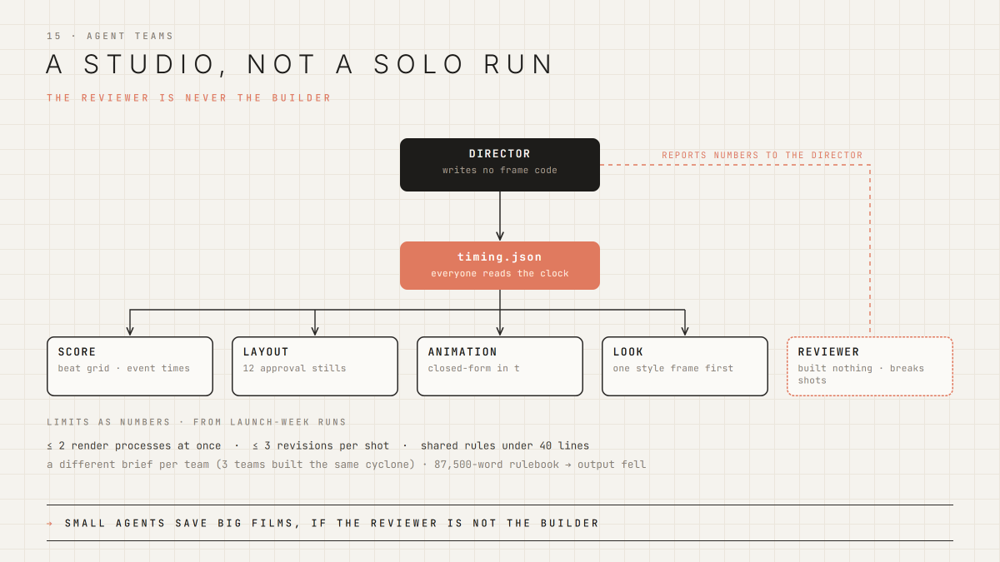</p>

## 16. Money: effort, limits and the real bills

Fable 5.2 is Anthropic's priciest widely available model: $8 per million input tokens, $40 per million output, 1M context, up to 128K output, thinking always on.

And here's the plot twist about effort. Someone asked it for the classic pelican on a bicycle at all 5 effort levels. Xhigh drew the best one. Max returned no image at all: it spent its 128,000 thinking tokens and drew nothing.

Independent benchmarks tell the same story. High and Xhigh scored the same (62) on one index, Max only 3 points higher, at almost 3x the price of High:

```
EFFORT   ~COST PER TASK   USE IT FOR
low      $3.10            renaming, small edits, a quick color swap
medium   $3.80            storyboards, stills, talking through a shot
high     $9.08            a film built from scratch, long unattended runs
xhigh    $14.83           the hardest 3D scene, when High measurably fell short
max      $26.54           almost never for visuals
```

What one overnight Max run looks like on the bill:

> **[Embedded post]** [@petergostev](https://x.com/petergostev/status/2120167560700383572) · Peter Gostev · Tue 10 Nov 2026 · 88,078 views · 976 likes
>
> $2,618 prompt - this is what Fable 5.2 (Max) built overnight
>
> > **Quoting** [@petergostev](https://x.com/petergostev/status/2119873616170881192):
> >
> > I loved making this one - Fable 5.2 - in this video I go over dozens of prompts, incl. one that cost $2,618 💀
> >
> > It's a great model, a LOT of things got better but not every single thing, it does make sense to use Opus still.
> >
> > https://www.youtube.com/watch?v=QwaU4yU0PdQ

<p align="center"><a href="https://raw.githack.com/HossamSalemOnline/fable-5.2-motion-design/main/docs/media/e04-v18-petergostev.mp4">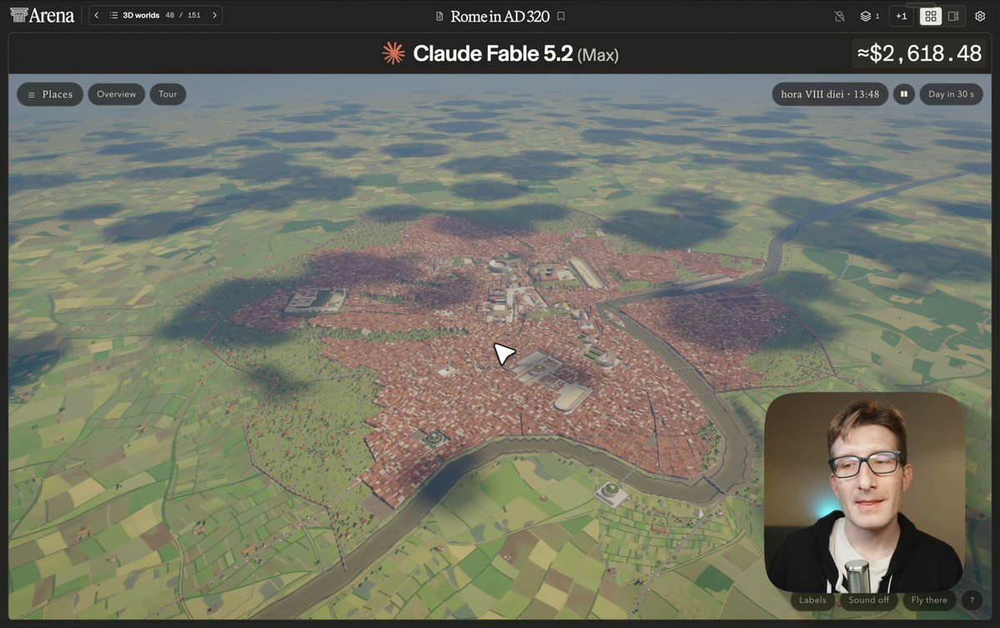</a><br>
<sub>▶ @petergostev video, 282 s, 572x360 · <a href="https://raw.githack.com/HossamSalemOnline/fable-5.2-motion-design/main/docs/media/e04-v18-petergostev.mp4">MP4</a></sub></p>

<p align="center">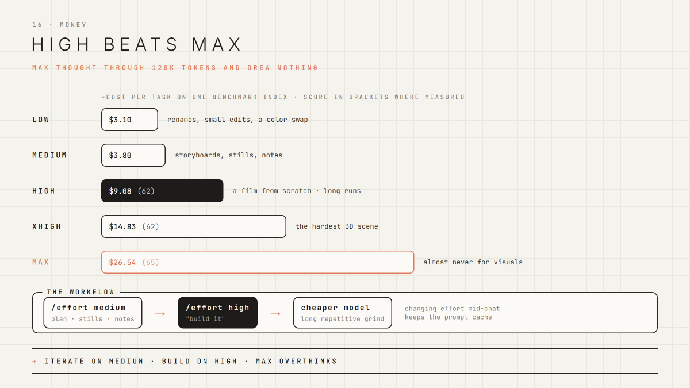</p>

Real bills for small stuff are way friendlier. From one creator's session logs, at API prices: a one-line YouTube intro: about 7 minutes, $3.65. The same intro from a director's brief: 2 minutes, $2.81. A vertical Reels post: $3.03. A 30-second 3D kids cartoon: 11 minutes, $9.34. Short 2D motion is cheap. Big 3D costs more. Either way it's a fraction of what a freelance motion designer charges for the same 10 seconds.

On subscriptions you don't pay per token, but Fable eats limits fast. Launch-week posts like "100% of 5hr usage drained in less than 20 min" were real.

How to keep the goose alive:

- **Iterate on Medium, build on High.** Storyboards, stills and notes don't need High. Type /effort medium for the planning, /effort high before you say "build it". Changing effort mid-conversation keeps the prompt cache
- **Fix on stills, not on renders.** One round of notes on stills before the first full render is the cheapest fix in the pipeline
- **Keep the cache warm.** Same folder, same long conversation. One heavy pipeline ran 80B tokens, about 98% of them cache reads
- **Plan with Fable, build with a cheaper model.** For anything that runs for hours, let Fable write the plan and shot list, and let a cheaper model like Sonnet 5.5 grind through the files
- **Pin the model in scripts.** claude -p --model sonnet for batch chores
- **Fast mode is for deadlines.** Up to 2.5x faster at 2x the price ($16 / $80)
- **Set a budget before you press enter.** Tell it how much time or money it has, and to stop and report when it gets close

## 17. Every format and size

Pick the size before you start. Changing it later means re-staging every shot.

```
WHERE YOU POST                    SIZE         SHAPE
YouTube, X (wide)                 1920x1080    16:9
X, Instagram feed (tall)          1080x1350    4:5
Reels, TikTok, Shorts, Stories    1080x1920    9:16
Square                            1080x1080    1:1
```

On X, 4:5 takes the most space in the feed on a phone. Posting the same video everywhere? Make it 9:16 and keep the text inside the middle 1080x1350, so the 4:5 crop still works.

For vertical, design for a phone: big text, one idea per screen, something moving from the very first frame. And two lines do the heavy lifting in any vertical prompt: "120 BPM, one beat = 0.5 s" puts every word on a beat, and "the last frame flows into the first" makes a loop people watch twice without noticing. The platform counts both views.

## 18. The toolbox

All free to start:

- **Remotion:** video in React, with official agent skills and a Claude Code plugin
- **HyperFrames:** write HTML, render video, built for agents
- **GSAP + gsap-skills:** UI motion and kinetic type, now 100% free
- **three.js:** 3D in the browser, on your GPU
- **Blender MCP + Blender skills plugin:** Claude drives Blender, live or by script
- **chrome-devtools-mcp:** the agent sees and records its own page
- **claude-video:** a /watch command that pulls frames and audio from any video for the agent to read
- **Mediabunny:** read, write and convert video in the browser, no ffmpeg
- **librosa:** finds the beat so every cut lands on it
- **faster-whisper:** captions from any voiceover

Install lines for the big three:

```
npx skills add remotion-dev/skills
claude plugin marketplace add remotion-dev/claude-code-plugin
claude plugin install remotion@remotion

claude plugin marketplace add heygen-com/hyperframes
claude plugin install hyperframes@hyperframes

npx skills add https://github.com/greensock/gsap-skills
```

Remotion is free for individuals and companies of up to 3 people. Bigger teams need a company license.

## 19. When it goes wrong (symptom → line to paste)

```
SYMPTOM                              PASTE THIS
stopped and offered to continue      "Finishing work: done = the MP4 renders and every QA check passes. Keep going."
thought for minutes, drew nothing    switch Max to High. Nothing else.
the hero is a dot                    "At least 170 px wide at 1080p in every main shot. Measure it, report numbers."
the hero's face is soft              "Focus follows his real depth on every frame. 85 mm for the face."
frozen graphics, checks passed       "Run freezedetect on a 30 fps draft, plot change per second, fix every freeze."
sound feels early or late            "Every hit is read from timing.json and lands 1 frame after its picture event."
the loop stutters at the seam        "Render frames 0 to N-1. Frame N-1 flows into frame 0: pose, speed, camera, light."
preview and render land differently  "Every spring and motion is closed-form in t. No state between frames."
things clip through each other       design it out: "the notes fall in a plane behind the keys, they never touch him."
the camera zooms to fake energy      "No zooms. Cut on the beat; a beautiful angle holds for a whole beat."
text cut at the edge                 "Every word fully in frame or fully out. Never half cut."
labels and subheaders you didn't want "Only the text listed here appears on screen. Nothing else."
purple gradient, glow orbs, flares   name them in a BANS line. Defaults leave when you name them.
limits gone by lunch                 Medium for stills and notes, High only for the build. Pin --model in scripts.
```

## 20. 4 prompts to steal

Every one is printed in full. Swap the nouns, keep the numbers.

**1. A vertical "of the week" post for Reels.** Change the three detail lines and the stamp, and it's a weekly series: book of the week, sneaker of the week, recipe of the week.

```
Make a 12-second vertical video for Reels and TikTok as one HTML file I can open in Chrome.
Everything is drawn in code: no images, no video files. Do it in one go without asking me questions.

WHAT: a "record of the week" post for my vinyl channel "Deep Cuts".
SIZE: 1080x1920 (vertical), 60 fps, a seamless loop: the last frame flows into the first.
LOOK: dark brown background #1E140E with a slow warm glow, cream text #F3E7D3, one accent burnt orange #E0592A.
Fonts from Google Fonts: a heavy condensed sans for the big words, a retro serif for the small ones.

TIMELINE (120 BPM, one beat = 0.5 s):
0.0-0.5 s: a vinyl record is already spinning in the top half on frame 1, no empty start.
0.5-4.0 s: "RECORD OF THE WEEK" lands one word per beat under the record, stacked, each with a small squash.
4.0-7.0 s: a card slides up, one line per beat: "Side B, Track 3", "Pressed in 1974", "Only 500 copies".
           "500" is orange and 1.5x bigger.
7.0-9.0 s: the record speeds up for one beat and a stamp "FOUND IT" slams onto the card with a 3-frame shake.
9.0-11.0 s: everything holds and pulses gently on every beat.
11.0-12.0 s: the text slides out and the record returns to its exact frame-1 position, so the loop has no seam.

MOTION: nothing moves in a straight line at constant speed. Entrances ease out, exits ease in.
SOUND: none.
```

**2. A video from your own material.** The Tuscany-ruin method:

```
Make a 30 second video, 1920x1080, 60 fps, with sound, about [YOUR STORY, PLACE OR PRODUCT].
I'm attaching [style images / a PDF with notes and photos]. Use them for the look and the facts.
Don't copy any image directly.

STORY: [ONE SENTENCE: what happens, and what the viewer should feel at the end].
LOOK:  [3 colors in hex, one font, one sentence about light and texture].
SHOTS (seconds):
0-3    hook: [the single most striking image]
3-10   [what we learn]
10-20  [the turn or the surprise]
20-27  [the payoff]
27-30  a held final frame
MOTION: things ease in and out, nothing moves at a constant speed, one main movement per shot.
SOUND:  made in code, no samples. Each sound lands one frame after the thing that causes it.
        Music at about [100] BPM, cuts on the beat.
BUILD:  one HTML file where every frame is a function of time. Render with Playwright, stitch with ffmpeg.
CHECK:  first write the shot list and wait for my go. Then show me one frame from each shot.
        After the render, look at a contact sheet of the whole video and fix anything that looks off.
```

**3. A 3D scene that looks directed, not random.** The trick: camera positions in meters and every action on the second.

```
Make a 24 s 3D scene in three.js as one HTML file, 1920x1080, 60 fps. Everything is code, zero assets.
SUBJECT: [a capybara in a snowy Japanese hot spring at dusk].
SHOTS (camera position and target in meters, lens in mm):
0-5 s    wide: camera (0, 2.2, 9) -> target (0, 0.6, 0), 35 mm, slow 0.2 m dolly in
5-10 s   medium: camera (2.5, 1.1, 3.5) -> target (0, 0.7, 0), 50 mm
10-15 s  close: camera (0.8, 0.9, 1.4) -> target (0, 0.8, 0), 85 mm, focus on the eyes
15-20 s  top-down: camera (0, 7, 0.1) -> target (0, 0, 0), 35 mm
20-24 s  back to wide, the last frame holds
ACTION: [one line per second-range: what moves and when].
LIGHT: low sun 3200 K from the left at 12 degrees, cool 7500 K sky fill, steam lit from behind.
QA: one still per shot before the full build; the subject is at least 300 px wide in shots 2 and 3.
```

**4. A small game that animates itself properly.** Skeletal animation plus frame checks:

```
Make a small 3D game that runs in the browser as one HTML file, using three.js.
The idea: [ONE SENTENCE: who the player is, what they do, how they win and how they lose].
Build everything yourself in code: models, textures, sound effects and music. No outside assets.
Characters use skeletal animation. Before you move on, render single frames of the walk and attack
cycles and check them one by one until the motion looks right.
When it's playable, play it yourself: screenshots at the start, the middle and the end, fix what
looks wrong, then play again. Stop when someone can play it start to finish.
Tell me what you'd improve next, but don't do it yet.
```

## TL;DR

- Fable 5.2 writes a web page that animates itself. You render it to an MP4
- One line gets you Fable's taste. A director's brief gets you yours
- Every adjective you replace with a number makes the film better
- One damping ratio decides how a landing feels. Say the number
- Write the clock first. Every frame is a function of time
- Stills lie. Make it measure motion, then press play yourself
- Fix with follow-ups that name a time and a number
- High for the build, Medium for everything else. Max overthinks

Your first video will take 10 minutes. Your fifth will look like you hired someone.

Bookmark this so the template is here when your next film needs it.

Follow @seeconvm for more.
