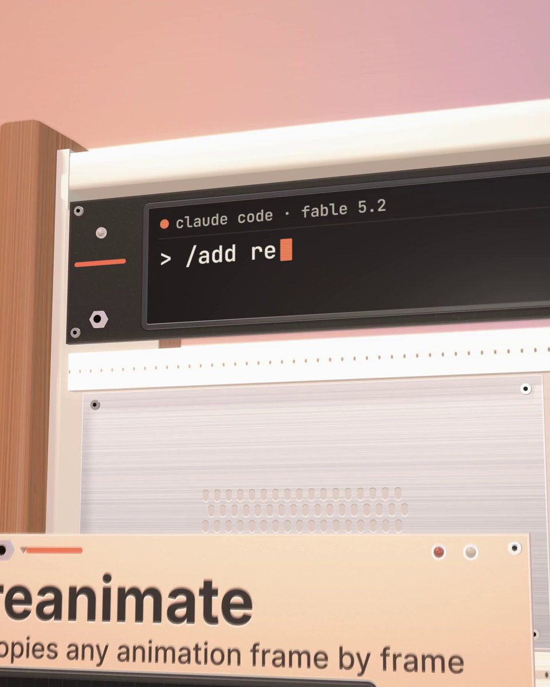

# I haven't opened After Effects in months, these 18 GitHub repos replaced it

- **Author:** soul ([@0xsoul](https://x.com/0xsoul))
- **Posted:** Sun 22 Nov 2026, 12:50 UTC
- **Source:** https://x.com/0xsoul/status/2124485659041604080
- **Quotes:** the course [Motion Design with Fable 5.2: From One Prompt to a Finished Film](04-article-seeco-motion-design-full-course.md) by @seeconvm (https://x.com/seeconvm/status/2122405510779375668)
- **Stats at capture (23 Nov 2026):** 60,136 views · 805 likes · 85 reposts · 6 quotes · 24 replies · 1,509 bookmarks
- **Captured via:** Apify (`xquik/x-tweet-scraper` for the post, `apidojo/tweet-scraper` for replies). All t.co short links expanded to their real URLs.

## Attached video

 
▶ Video, 30 s, 1440x1800 (4:5) · <a href="https://raw.githack.com/HossamSalemOnline/fable-5.2-motion-design/main/docs/media/e05-v1-18-repos-post.mp4">MP4</a>

## Full post text (verbatim, links expanded)

I haven't opened After Effects in months, these 18 GitHub repos replaced it

this is f*cking gold for Fable 5.2

Rebuild. Time. Paint. Glow. Sync. Caption.

reanimate → rebuild any animation you see, frame by frame
https://github.com/NiazMorshed2007/reanimate

motion-design-skill → timing and easing like a trained animator
https://github.com/LottieFiles/motion-design-skill

mg-styles-15 → 15 motion styles, one prompt each
https://github.com/Vincentwei1021/mg-styles-15

huashu-art-motion → paintings that move in 35 art styles
https://github.com/alchaincyf/huashu-art-motion

anidoodle → doodles and loops, all in code
https://github.com/alexgreensh/anidoodle

cinetic → launch films straight from code
https://github.com/Leonxlnx/cinetic

motionmaxxing → turns AI slop into designer-level motion
https://github.com/Tejashmakwana/motionmaxxing

Manim → turns formulas into smooth animation
https://github.com/ManimCommunity/manim

blender-skills → pro Blender tricks your agent can use
https://github.com/EL4CTEO/blender-skills

three.quarks → particle effects that make every scene pop
https://github.com/Alchemist0823/three.quarks

react-postprocessing → the cinematic finish on every frame
https://github.com/pmndrs/react-postprocessing

Tweakpane → sliders for every tiny detail
https://github.com/cocopon/tweakpane

EffectCraft → fast compositing, built in Rust
https://github.com/storytold/effectcraft

Openverse → free sounds and music for every scene
http://api.openverse.org/v1/

librosa → finds the beat so your motion follows it
https://github.com/librosa/librosa

WhisperX → word-perfect captions, timed to the millisecond
https://github.com/m-bain/whisperX

Remotion Skills → official video skills for any coding agent
https://github.com/remotion-dev/skills

FFmpeg → turns your animation into a real video file
https://github.com/FFmpeg/FFmpeg

See → rebuild → polish → score → export.

Bookmark this, then the guide below shows how to rebuild your first animation tonight ↓

## Quick-reference table

| # | Tool | What it does (author's line) | Stage | Link |
|---|---|---|---|---|
| 1 | reanimate | rebuild any animation you see, frame by frame | Rebuild | [NiazMorshed2007/reanimate](https://github.com/NiazMorshed2007/reanimate) |
| 2 | motion-design-skill | timing and easing like a trained animator | Time | [LottieFiles/motion-design-skill](https://github.com/LottieFiles/motion-design-skill) |
| 3 | mg-styles-15 | 15 motion styles, one prompt each | Paint | [Vincentwei1021/mg-styles-15](https://github.com/Vincentwei1021/mg-styles-15) |
| 4 | huashu-art-motion | paintings that move in 35 art styles | Paint | [alchaincyf/huashu-art-motion](https://github.com/alchaincyf/huashu-art-motion) |
| 5 | anidoodle | doodles and loops, all in code | Paint | [alexgreensh/anidoodle](https://github.com/alexgreensh/anidoodle) |
| 6 | cinetic | launch films straight from code | Paint | [Leonxlnx/cinetic](https://github.com/Leonxlnx/cinetic) |
| 7 | motionmaxxing | turns AI slop into designer-level motion | Time | [Tejashmakwana/motionmaxxing](https://github.com/Tejashmakwana/motionmaxxing) |
| 8 | Manim | turns formulas into smooth animation | Paint | [ManimCommunity/manim](https://github.com/ManimCommunity/manim) |
| 9 | blender-skills | pro Blender tricks your agent can use | Paint | [EL4CTEO/blender-skills](https://github.com/EL4CTEO/blender-skills) |
| 10 | three.quarks | particle effects that make every scene pop | Glow | [Alchemist0823/three.quarks](https://github.com/Alchemist0823/three.quarks) |
| 11 | react-postprocessing | the cinematic finish on every frame | Glow | [pmndrs/react-postprocessing](https://github.com/pmndrs/react-postprocessing) |
| 12 | Tweakpane | sliders for every tiny detail | Glow | [cocopon/tweakpane](https://github.com/cocopon/tweakpane) |
| 13 | EffectCraft | fast compositing, built in Rust | Glow | [storytold/effectcraft](https://github.com/storytold/effectcraft) |
| 14 | Openverse | free sounds and music for every scene | Sync | [api.openverse.org/v1](http://api.openverse.org/v1/) (an API, not a GitHub repo) |
| 15 | librosa | finds the beat so your motion follows it | Sync | [librosa/librosa](https://github.com/librosa/librosa) |
| 16 | WhisperX | word-perfect captions, timed to the millisecond | Caption | [m-bain/whisperX](https://github.com/m-bain/whisperX) |
| 17 | Remotion Skills | official video skills for any coding agent | Caption | [remotion-dev/skills](https://github.com/remotion-dev/skills) |
| 18 | FFmpeg | turns your animation into a real video file | Export | [FFmpeg/FFmpeg](https://github.com/FFmpeg/FFmpeg) |

The "Stage" column is my mapping onto the post's own "Rebuild. Time. Paint. Glow. Sync. Caption." line; the author did not label each repo. Note the post says 18 GitHub repos, but Openverse is linked as an API rather than a repo.

## Replies captured (10 of 24 shown publicly)

| Time (UTC) | Author | Reply | Likes |
|---|---|---|---|
| 22 Nov 16:16 | [@shafinbinnur](https://x.com/shafinbinnur/status/2124537557824471545) | reanimate repo is lowkey game changer tbh | 9 |
| 22 Nov 16:45 | [@0xkryx](https://x.com/0xkryx/status/2124544732009480252) | These repos was lit 🔥 | 7 |
| 22 Nov 17:23 | [@TomO85613447](https://x.com/TomO85613447/status/2124554346599985529) | Sure, if you're creating garbage content. You do you. | 8 |
| 22 Nov 18:04 | [@itsTeko0](https://x.com/itsTeko0/status/2124564646212628558) | motionmaxxing is the best repo name I've seen lol | 12 |
| 22 Nov 19:16 | [@syowro](https://x.com/syowro/status/2124582696299229437) | Fire I want to try | 8 |
| 22 Nov 19:25 | [@An_yhl](https://x.com/An_yhl/status/2124585164852600944) | Installing 18 repos in one go, I'd probably spend half a day setting up the environment first 😂 *(translated from Chinese)* | 7 |
| 22 Nov 22:58 | [@sirt_ai_](https://x.com/sirt_ai_/status/2124638739762921632) | @bot, do I use these? *(translated from Japanese)* | 3 |
| 22 Nov 23:38 | [@__mharrison__](https://x.com/__mharrison__/status/2124648756188717539) | Thanks for sharing | 5 |
| 23 Nov 02:36 | [@sofiacorvetti](https://x.com/sofiacorvetti/status/2124693509554966961) | 18 repos to take motion design to the next level without depending on After Effects, this is gold for anyone working with AI *(translated from Spanish)* | 0 |
| 23 Nov 06:09 | [@fountible](https://x.com/fountible/status/2124747101041275153) | or skip the 18 repos, describe it and bro animates it on a canvas. editable after | 0 |
